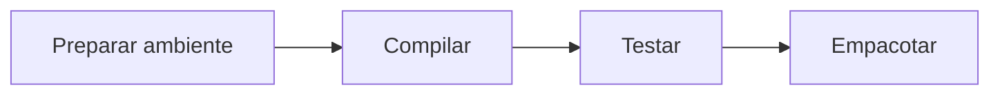
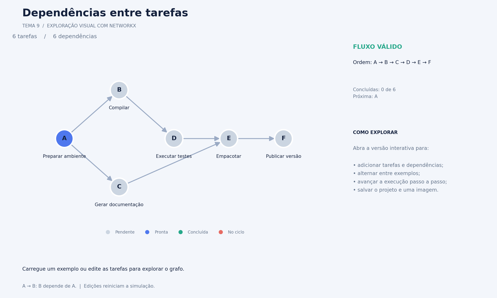
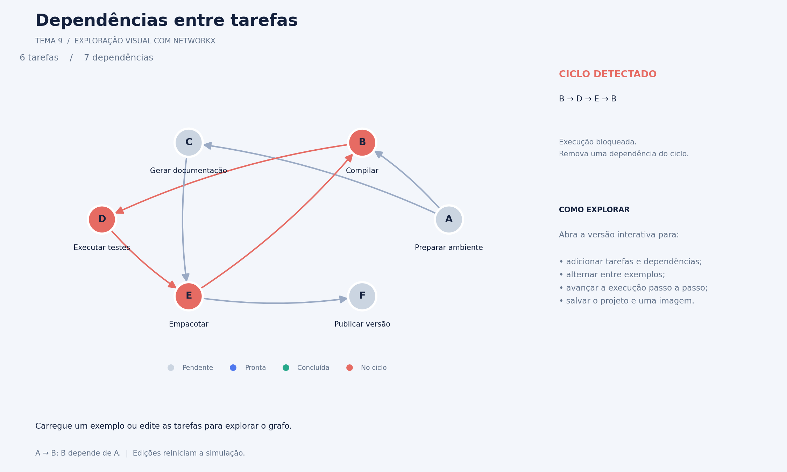

# Gestão de Conflitos em Sistemas de Dependência

Trabalho prático de Grafos — **Tema 9**.

O projeto propõe uma ferramenta para gerenciar dependências entre tarefas usando grafos dirigidos. O objetivo é identificar dependências circulares, visualizar as relações entre tarefas e simular sua execução em uma ordem que respeite todos os pré-requisitos.

## Integrantes

- Lucas Batista
- Caio Kfuri
- Arthur
- Rafael Abras
- David
- Joao Heleno

## Status do projeto

O projeto tem um **protótipo visual com NetworkX e Matplotlib**, criado para explorar a ideia e validar os fluxos da interface. A implementação acadêmica com estrutura de grafos e algoritmos próprios ainda está planejada.

O protótipo fica em [`prototypes/networkx_preview/`](prototypes/networkx_preview/) e permite editar tarefas e dependências, visualizar ciclos e simular a execução passo a passo.

**Atenção ao escopo acadêmico:** o PDF permite bibliotecas prontas de grafos apenas para comparação de desempenho. Este protótipo exploratório usa NetworkX e não atende a essa restrição como implementação final; a versão entregue deverá usar implementação própria, salvo autorização do professor.

## Objetivos

- Modelar tarefas e suas dependências por meio de um grafo dirigido.
- Implementar uma estrutura própria de grafos e seus algoritmos.
- Detectar ciclos e apresentar as tarefas envolvidas em um conflito.
- Calcular uma ordenação topológica para grafos acíclicos.
- Construir uma interface gráfica para visualizar o grafo e os resultados.
- Simular a execução das tarefas respeitando suas dependências.
- Avaliar a correção, a complexidade e o desempenho da solução.

## Modelagem

Cada **vértice** representa uma tarefa, e cada **aresta dirigida** representa uma dependência obrigatória.

A convenção utilizada será: **`A → B` significa que B depende de A**. Assim, A precisa ser concluída antes de B.

Exemplo de fluxo sem conflito:



Nesse exemplo, uma ordem válida é preparar o ambiente, compilar, testar e empacotar.

Se uma dependência adicional fizer uma tarefa depender, direta ou indiretamente, dela mesma, haverá um ciclo. A ferramenta deverá indicar o conflito e bloquear a simulação até que as dependências sejam corrigidas.

## Funcionalidades planejadas para a versão final

- [ ] Cadastro, edição e remoção de tarefas.
- [ ] Cadastro e remoção de dependências.
- [ ] Importação e exportação de projetos em JSON.
- [ ] Visualização do grafo com indicação da direção das dependências.
- [ ] Detecção de ciclos com apresentação de um caminho que evidencie o conflito.
- [ ] Ordenação topológica pelo algoritmo de Kahn.
- [ ] Simulação sequencial da execução das tarefas.
- [ ] Exibição dos estados e do histórico da simulação.
- [ ] Testes automatizados e experimentos de desempenho.

A execução prevista é uma simulação dos estados das tarefas, sem execução de comandos externos ou instalação de pacotes.

## Algoritmos previstos

| Algoritmo | Finalidade | Complexidade de tempo esperada |
| --- | --- | --- |
| Busca em profundidade (DFS) | Detectar e reconstruir um ciclo no grafo. | `O(V + E)` |
| Kahn | Calcular uma ordenação topológica ou identificar a impossibilidade de uma ordem completa. | `O(V + E)` |

`V` representa a quantidade de tarefas, e `E`, a quantidade de dependências. Essas complexidades consideram listas de adjacência e, no algoritmo de Kahn, uma fila FIFO.

## Tecnologias propostas

- **Python:** implementação da ferramenta e dos algoritmos.
- **Tkinter e Canvas:** interface gráfica e desenho do grafo.
- **JSON:** armazenamento dos projetos.
- **unittest:** testes automatizados.
- **Git:** versionamento e registro das contribuições individuais.
- **LaTeX com template SBC:** elaboração do relatório técnico.

A stack ainda poderá ser ajustada pelo grupo. Conforme o enunciado, a criação e o processamento do grafo devem ter implementação própria; bibliotecas prontas, como NetworkX, são permitidas apenas para comparação de desempenho.

## Documentação disponível

| Arquivo | Conteúdo |
| --- | --- |
| [TP.pdf](TP.pdf) | Enunciado oficial com temas, requisitos e regras de entrega. |
| [agent.md](agent.md) | Guia detalhado com escopo, modelagem, arquitetura proposta, algoritmos, testes e planejamento. |
| [README.md](README.md) | Apresentação inicial do projeto e da equipe. |
| [Índice da documentação](docs/README.md) | Navegação pelos guias e artefatos do projeto. |
| [Documentação do protótipo](docs/prototipo-networkx/README.md) | Guia de uso, arquitetura, galeria com seis cenários e reprodução das imagens. |

## Executar o protótipo visual

Requer **Python 3.9 ou superior**. Na raiz do repositório:

```bash
python3 -m venv .venv
source .venv/bin/activate
python -m pip install -r prototypes/networkx_preview/requirements.txt
python -m prototypes.networkx_preview
```

A janela permite alternar entre um exemplo válido e outro com ciclo, adicionar e remover tarefas e dependências, avançar a simulação e salvar JSON e PNG em `outputs/prototipo-networkx/`.

Para abrir diretamente o exemplo com conflito:

```bash
python -m prototypes.networkx_preview --exemplo com_ciclo
```

Para gerar uma imagem sem abrir uma janela:

```bash
python -m prototypes.networkx_preview --exportar outputs/grafo.png
```

Para executar os testes do protótipo:

```bash
MPLBACKEND=Agg python -m unittest prototypes.networkx_preview.test_preview -v
```

### Prévias

Interface completa do protótipo:


[Ver a galeria completa e a explicação dos cenários](docs/prototipo-networkx/README.md#4-interface-e-galeria-de-imagens).

Fluxo válido com tarefas organizadas por dependência:



Conflito com destaque do ciclo que bloqueia a execução:



## Etapas e entregas

1. **Modelagem e planejamento:** definição do problema, levantamento de dados, modelagem do grafo, diagramas UML e plano de desenvolvimento.
2. **Desenvolvimento:** implementação do grafo, algoritmos, interface gráfica, testes e avaliação de desempenho.
3. **Relatório e apresentação:** relatório em LaTeX no template SBC, demonstração da ferramenta, slides e vídeo.

O relatório deverá ter **12 a 15 páginas**. A apresentação presencial terá **10 minutos**, e o vídeo deverá ter **12 a 18 minutos**, com participação dos integrantes e explicação de suas contribuições.

A entrega inclui um arquivo `.zip` com o código-fonte da ferramenta, os fontes do relatório e o PDF final, além dos demais materiais exigidos. Cada integrante deverá realizar sua própria entrega no Canvas e confirmar ali o prazo e as instruções de envio.
