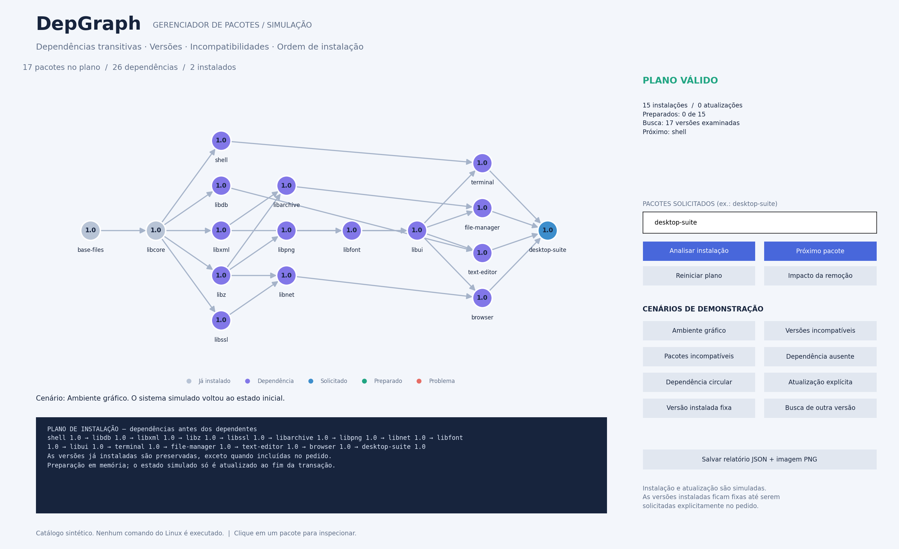
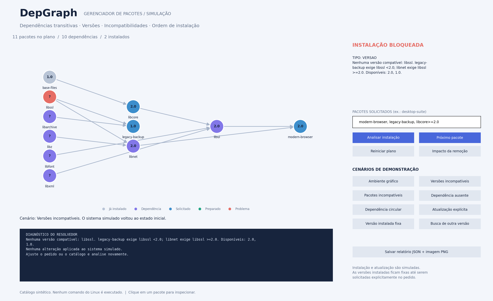

# DepGraph — Gestão de Conflitos em Sistemas de Dependência

Trabalho prático de Grafos — **Tema 9**.

O DepGraph é um simulador de gerenciamento de pacotes inspirado no Linux. A partir de um pedido de instalação, um catálogo e um estado de pacotes já instalados, identifica dependências transitivas, seleciona versões compatíveis, detecta conflitos e calcula uma ordem segura de instalação.

## Integrantes

- Lucas Batista
- Caio Kfuri
- Arthur
- Rafael Abras
- David
- Joao Heleno

## Estado atual

O protótipo visual usa **NetworkX e Matplotlib** e contém **27 pacotes com 32 versões** em um catálogo sintético. O exemplo principal instala um ambiente gráfico com **17 pacotes e 26 dependências**, preservando os dois pacotes inicialmente instalados.

A aplicação funciona em uma janela local e simula transações em memória. Os nomes, versões e relações são fictícios; nenhum comando Linux é executado.

O primeiro exemplo genérico de tarefas foi substituído por este foco em pacotes. Seu [registro histórico](docs/prototipo-networkx/tarefas-historico.md) foi preservado.

## Funcionalidades do protótipo

- Resolução de dependências diretas e transitivas.
- Restrições de versão e seleção de uma versão por pacote.
- Busca de versões alternativas por backtracking.
- Diagnósticos separados para incompatibilidade de versões, conflitos declarados, dependências ausentes e ciclos.
- Preservação das versões instaladas, com atualização explícita e verificação dos dependentes existentes.
- Plano de instalação baseado em ordenação topológica.
- Preparação passo a passo, com atualização do estado instalado ao concluir toda a transação simulada.
- Análise dos dependentes afetados por uma remoção.
- Inspeção de versões e relações clicando nos vértices.
- Exportação de relatório JSON e imagens PNG.

## Executar

Requer Python 3.9 ou superior. Na raiz:

```bash
python3 -m venv .venv
source .venv/bin/activate
python -m pip install -r prototypes/networkx_preview/requirements.txt
python -m prototypes.networkx_preview
```

Para demonstrar versões incompatíveis:

```bash
python -m prototypes.networkx_preview --cenario versoes
```

Para planejar uma atualização explícita:

```bash
python -m prototypes.networkx_preview --pedidos "modern-browser, libcore>=2.0"
```

Para listar o catálogo ou exportar uma imagem sem abrir janela:

```bash
python -m prototypes.networkx_preview --listar
python -m prototypes.networkx_preview --cenario conflito --exportar outputs/conflito.png
```

## Visualização





[Ver os dez cenários ilustrados e suas explicações](docs/prototipo-networkx/README.md#5-interface-e-galeria).

## Modelagem

Cada vértice do plano representa um pacote com sua versão selecionada. A convenção **A → B** significa que **B depende de A**. A ordem topológica coloca bibliotecas e demais pré-requisitos antes dos aplicativos que os utilizam.

Conflitos de coexistência e restrições de versão são verificados separadamente. Um grafo sem ciclo ainda pode representar um pedido impossível por exigir versões incompatíveis da mesma biblioteca.

O resolvedor faz backtracking sobre as versões disponíveis. Esse custo pode ser exponencial; a análise linear `O(V + E)` vale para a ordenação e a detecção de ciclos isoladamente, e não para toda a resolução.

## Documentação

| Documento | Conteúdo |
| --- | --- |
| [Índice de docs](docs/README.md) | Organização dos guias e artefatos. |
| [Guia do protótipo](docs/prototipo-networkx/README.md) | Uso, modelagem, cenários, arquitetura, formato dos dados e limitações. |
| [agent.md](agent.md) | Requisitos acadêmicos e planejamento da versão final com foco em pacotes. |
| [TP.pdf](TP.pdf) | Enunciado original do professor. |

## Testes e reprodução das imagens

```bash
MPLBACKEND=Agg python -m unittest prototypes.networkx_preview.test_packages prototypes.networkx_preview.test_preview -v
python -m prototypes.networkx_preview.gerar_imagens
```

Há 29 testes entre a versão atual de pacotes e o exemplo histórico de tarefas. O gerador reproduz as dez imagens de pacotes presentes na documentação.

## Entrega acadêmica

O protótipo NetworkX é exploratório. O PDF restringe bibliotecas prontas de grafos a comparações de desempenho; a versão final deverá usar estrutura e processamento de grafos implementados pelo grupo, salvo autorização do professor.

A entrega inclui modelagem com UML, código versionado com contribuições individuais, relatório de **12 a 15 páginas em LaTeX no template SBC**, slides, apresentação presencial de **10 minutos** e vídeo de **12 a 18 minutos**. Cada integrante deverá realizar sua própria entrega e confirmar no Canvas o prazo e o envio de todos os materiais.
