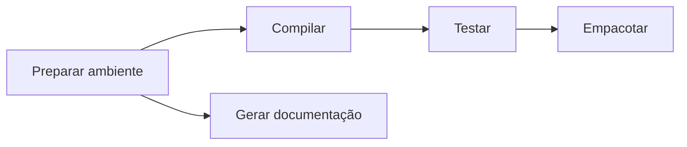
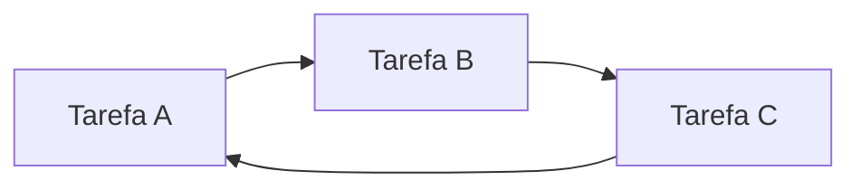
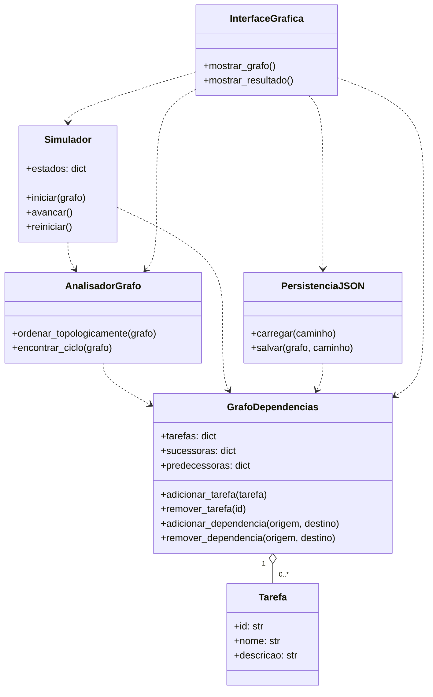

# Guia do projeto — Gestão de Conflitos em Sistemas de Dependência

Este documento orienta o planejamento, a implementação, os testes e a entrega do trabalho de Grafos do grupo, que escolheu o **tema 9**. A fonte dos requisitos acadêmicos é o arquivo [TP.pdf](TP.pdf), presente na raiz do repositório.

**Decisão posterior do grupo:** a pedido do usuário, foi criado um protótipo exploratório em [`prototypes/networkx_preview/`](prototypes/networkx_preview/) usando NetworkX e Matplotlib para a visualização inicial. Esse protótipo também usa a biblioteca para análise de ciclos e ordenação, sem representar implementação própria. A escolha foi autorizada para essa exploração; a restrição do PDF continua registrada para a entrega acadêmica. As orientações de implementação própria abaixo se referem à versão final. Ver [documentação do protótipo](docs/prototipo-networkx/README.md).

**Organização da documentação:** centralizar os guias e artefatos explicativos em [`docs/`](docs/README.md), com subpastas por assunto e imagens junto ao respectivo guia. Este `agent.md` e o enunciado original permanecem na raiz.

As seções identificadas como **exigências do enunciado** resumem o PDF. As demais apresentam uma **proposta de solução para o grupo**, que pode ser ajustada sem perder os requisitos obrigatórios. Este guia não substitui o relatório em LaTeX; a implementação final descrita aqui permanece planejada.

## 1. Tema e objetivo

### Exigências do enunciado

O tema 9, apresentado na página 2 do PDF, é:

> Gestão de Conflitos em Sistemas de Dependência

O sistema deve modelar dependências entre tarefas ou pacotes, detectar ciclos, visualizar dependências e permitir execução segura baseada em ordenação topológica.

O objetivo geral do trabalho é desenvolver uma ferramenta computacional que use grafos como estrutura central para resolver um problema aplicado. O grupo deve definir a estrutura do grafo, implementar algoritmos adequados, construir uma interface de interação, avaliar os resultados, demonstrar a correção da solução, analisar sua complexidade e discutir suas limitações.

### Proposta para o grupo

Desenvolver um **gerenciador de dependências entre tarefas**, com cadastro de tarefas, definição de pré-requisitos, visualização do grafo e simulação da execução em uma ordem válida.

Exemplo de aplicação: um fluxo de desenvolvimento em que compilar depende de preparar o ambiente, testar depende de compilar e empacotar depende de testar.

Neste projeto, um conflito estrutural é uma dependência circular que impede a conclusão de todas as tarefas. Conflitos de versões de pacotes, disponibilidade de recursos e incompatibilidades de software ficam fora do escopo proposto.

## 2. Regras acadêmicas e entregas obrigatórias

As informações abaixo foram extraídas das páginas 1 a 3 do PDF:

| Item | Exigência |
| --- | --- |
| Valor | 15 pontos. |
| Grupo | Até 6 alunos. |
| Linguagem | C/C++, Java ou Python. |
| Interface | Interface gráfica que apresente os resultados; o PDF não limita o framework de frontend. |
| Grafos | Implementação própria da criação e do processamento do grafo. Bibliotecas prontas, como NetworkX, são proibidas, salvo para comparação de desempenho. |
| Versionamento | Código e histórico de desenvolvimento no Git; commits individuais serão avaliados. |
| Modelagem | A utilização de diagramas UML será avaliada. |
| Relatório | De 12 a 15 páginas, em LaTeX, usando obrigatoriamente o template oficial da SBC. |
| Conteúdo do relatório | Contextualização, modelagem, artefatos, diagramas, telas, resultados, desempenho, conclusões e responsabilidades de cada integrante. |
| Apresentação presencial | Apresentação oral com demonstração, slides, participação de todos os integrantes e duração de 10 minutos. |
| Vídeo | Entre 12 e 18 minutos, com foco no funcionamento e na explicação das funcionalidades produzidas por cada aluno. |
| Pacote de entrega | Arquivo `.zip` contendo o código-fonte da ferramenta, o código-fonte do relatório (`.tex`) e o PDF do relatório. |
| Entrega individual | Cada integrante deve entregar sua própria cópia no Canvas; a entrega de outro membro não substitui essa obrigação. |
| Prazo | O cabeçalho informa **22/11**, sem ano. O texto determina entrega até **23:59**, observando a data da tarefa no Canvas. Confirmar o prazo no Canvas. |
| Integridade | Cópias serão zeradas. O PDF também informa que a falta de qualquer item obrigatório resulta em nota zero. |

Template indicado pelo enunciado: [SBC Conferences Template no Overleaf](https://www.overleaf.com/latex/templates/sbc-conferences-template/blbxwjwzdngr).

O PDF exige vídeo e slides, mas não detalha como enviá-los. Conferir no Canvas a forma de entrega desses materiais e do endereço do repositório, sem presumir que apenas o `.zip` atende a todos os itens.

Variações do tema precisam de autorização prévia do professor. O recorte de tarefas proposto aqui corresponde diretamente à alternativa de tarefas descrita no tema 9.

## 3. Escopo funcional proposto

### Funcionalidades principais

1. Cadastrar tarefas com identificador único, nome e descrição opcional.
2. Editar os dados descritivos e remover tarefas.
3. Cadastrar e remover dependências entre tarefas existentes.
4. Carregar e salvar um projeto em arquivo JSON.
5. Mostrar o grafo dirigido com nomes e setas legíveis.
6. Detectar se existe ciclo e apresentar pelo menos um caminho que o evidencie.
7. Calcular e apresentar uma ordenação topológica quando o grafo for acíclico.
8. Simular a execução das tarefas respeitando suas dependências.
9. Exibir mensagens claras para entradas inválidas, ciclos e estados de execução.
10. Disponibilizar exemplos válidos e exemplos com ciclos para testes e demonstração.

Essas funcionalidades detalham a proposta do grupo; o PDF não exige especificamente JSON, campos de cadastro ou uma linguagem de interface.

### Limites da primeira versão

- A execução será uma **simulação**, com estados de tarefas exibidos pela ferramenta. O sistema não executará comandos do sistema operacional nem instalará pacotes. Essa interpretação de execução segura deverá ficar explícita no relatório e na apresentação.
- As dependências serão obrigatórias: uma tarefa somente pode executar depois que todos os seus pré-requisitos forem concluídos.
- A execução simulada será sequencial. Paralelismo, prioridades, duração estimada e caminho crítico são extensões opcionais.
- O sistema identificará conflitos, mas não removerá automaticamente dependências para resolvê-los. O usuário decidirá qual relação corrigir.

## 4. Modelagem do grafo

### Definição formal

Utilizar um grafo dirigido `G = (V, E)`:

- Cada vértice de `V` representa uma tarefa.
- Cada aresta de `E` representa uma dependência obrigatória.
- A convenção será **`A → B` significa que B depende de A**. Portanto, A precisa terminar antes de B.
- O grafo não terá pesos na primeira versão.
- Arestas repetidas serão rejeitadas ou tratadas como operação sem efeito, sem alterar os graus.
- Um laço `A → A` será considerado ciclo e apresentado como conflito.
- Componentes desconexas e tarefas isoladas serão permitidas.

Essa direção deve ser preservada no código, no JSON, nos diagramas, nos testes e na interface. Inverter o significado de uma aresta leva a uma ordem de execução incorreta.

### Estruturas de dados propostas

Implementar uma classe própria `GrafoDependencias` usando estruturas básicas da linguagem:

- Mapa de identificadores para objetos `Tarefa`.
- Lista de adjacência: para cada tarefa, guardar suas sucessoras, que dependem dela.
- Mapa de predecessoras para consultar os pré-requisitos de cada tarefa.
- Grau de entrada calculado a partir das dependências ou mantido de forma consistente nas operações de edição.

Uma representação com mapas e conjuntos evita arestas duplicadas e permite consultar tarefas por identificador. As complexidades com mapas e conjuntos pressupõem operações de acesso com custo médio constante.

Os algoritmos devem trabalhar sobre essa implementação própria. Não delegar criação, detecção de ciclos, ordenação ou outros processamentos a bibliotecas de grafos.

### Exemplo sem conflito



Uma ordem válida é: preparar ambiente, compilar, testar, empacotar e gerar documentação. A documentação também pode aparecer antes de compilar, desde que seja executada depois de preparar o ambiente.

Uma ordenação topológica não é necessariamente única. O critério de correção é respeitar todas as arestas.

### Exemplo com conflito



O caminho `A → B → C → A` forma um ciclo. Nenhuma dessas três tarefas pode iniciar respeitando todos os pré-requisitos.

## 5. Algoritmos e comportamento esperado

### 5.1. Ordenação topológica — algoritmo de Kahn

Implementação proposta:

1. Calcular uma cópia dos graus de entrada de todos os vértices.
2. Inserir em uma fila todos os vértices com grau de entrada zero.
3. Retirar um vértice da fila e adicioná-lo à ordem resultante.
4. Para cada sucessor, diminuir o grau de entrada na cópia e colocá-lo na fila quando o grau chegar a zero.
5. Repetir até a fila ficar vazia.
6. Comparar a quantidade de vértices processados com `|V|`.

Se todos forem processados, a ordem é válida. Caso contrário, existe ciclo e não existe ordenação topológica completa.

A operação não deve modificar as dependências ou os graus persistentes do projeto. Executar a análise várias vezes deve produzir resultados consistentes.

**Política proposta:** se houver qualquer ciclo, bloquear a simulação completa, mesmo que Kahn encontre um prefixo executável em outra parte do grafo. Mostrar esse prefixo, se desejado, apenas como resultado parcial da análise.

Os vértices restantes após Kahn podem incluir tarefas apenas bloqueadas por um ciclo. Não afirmar que todos eles pertencem ao ciclo.

### 5.2. Identificação de um ciclo — busca em profundidade

Implementar DFS com três estados:

- Branco: vértice ainda não visitado.
- Cinza: vértice no caminho de busca atual.
- Preto: vértice com exploração concluída.

Uma aresta que aponta para um vértice cinza identifica um ciclo. Manter predecessores da busca ou a pilha do caminho ativo para reconstruir e apresentar uma sequência como `A → B → C → A`.

A busca precisa iniciar também nos vértices ainda não visitados de outras componentes. Um ciclo fora da componente inicial também deve ser encontrado.

Preferir implementação iterativa quando forem usados grafos grandes, evitando o limite de recursão da linguagem. Se a implementação for recursiva, documentar esse limite.

Detectar pelo menos um ciclo é suficiente para a proposta inicial. Encontrar todos os ciclos simples não faz parte do escopo. Componentes fortemente conexas podem ser uma extensão, caso o grupo queira identificar todos os grupos envolvidos em dependências circulares.

### 5.3. Simulação de execução segura

Estados propostos: `pendente`, `em execução` e `concluída`.

Fluxo:

1. Validar o grafo e calcular a ordenação topológica.
2. Se houver ciclo, mostrar o conflito e manter a execução bloqueada.
3. Se o grafo for acíclico, disponibilizar início e avanço passo a passo.
4. Antes de executar cada tarefa, verificar que todas as suas predecessoras estão concluídas.
5. Atualizar a tarefa atual, os estados e o histórico visível na interface.
6. Ao concluir todas as tarefas, apresentar o resultado final.

Qualquer alteração em tarefas ou dependências invalida a ordem calculada e os estados da simulação. A próxima execução deve partir de nova análise. Uma opção simples é bloquear edição enquanto a simulação estiver em andamento e exigir seu encerramento para editar.

### 5.4. Justificativa de correção

O relatório deve explicar que Kahn seleciona apenas vértices sem predecessores pendentes. Ao retirar uma tarefa, remove conceitualmente suas arestas de saída; assim, cada tarefa adicionada à ordem tem todos os seus pré-requisitos anteriores a ela.

Se o algoritmo parar antes de processar todos os vértices, cada vértice restante possui algum predecessor restante. Em um grafo finito, seguir essas dependências leva à repetição de um vértice, evidenciando um ciclo.

Na DFS, uma aresta para um vértice cinza fecha um caminho dirigido ainda ativo e, portanto, forma um ciclo. A verificação dos pré-requisitos antes de cada passo preserva a regra de execução da simulação.

### 5.5. Complexidade esperada

Considere `V` como o conjunto de tarefas e `E` como o conjunto de dependências.

| Operação | Tempo esperado | Memória adicional |
| --- | --- | --- |
| Armazenar o grafo e as predecessoras | Construção em `O(|V| + |E|)` | Estrutura total em `O(|V| + |E|)`. |
| Calcular graus de entrada | `O(|V| + |E|)` | `O(|V|)`. |
| Ordenar com Kahn usando fila | `O(|V| + |E|)` | `O(|V|)`, sem contar o grafo. |
| Buscar e reconstruir um ciclo com DFS | `O(|V| + |E|)` | `O(|V|)`, sem contar o grafo. |
| Validar uma ordem fornecida | `O(|V| + |E|)` | `O(|V|)` para posições e identificação dos vértices. |
| Simular toda a sequência, verificando cada pré-requisito uma vez | `O(|V| + |E|)` | `O(|V|)` para estados e histórico. |

Usar fila FIFO e critérios de inserção definidos para reprodutibilidade. Se o grupo optar por ordenar candidatos continuamente ou usar uma fila de prioridade, atualizar a análise de complexidade, pois a ordenação pode acrescentar fatores logarítmicos.

O custo de renderizar o grafo e atualizar a interface deve ser discutido separadamente do custo dos algoritmos.

## 6. Tecnologia e arquitetura propostas

O enunciado permite C/C++, Java ou Python e não determina uma stack. Para uma primeira versão, recomenda-se **Python com Tkinter e Canvas**, mantendo a interface e a lógica na mesma linguagem. Verificar a disponibilidade do Tkinter no ambiente do grupo.

- Estruturas básicas de Python para a implementação própria do grafo.
- `collections.deque` para a fila de Kahn.
- `json` para persistência.
- `tkinter` e `Canvas` para formulários, mensagens, desenho de vértices e setas.
- `unittest` para testes automatizados.
- `time.perf_counter` para medições dos algoritmos.
- LaTeX com template SBC para o relatório.

O uso dessas ferramentas auxiliares não substitui a implementação dos algoritmos de grafos. A visualização proposta deve desenhar a estrutura já mantida pelo programa, sem recorrer a bibliotecas prontas de criação ou processamento de grafos.

### Organização sugerida do repositório

```text
.
├── TP.pdf
├── agent.md
├── README.md
├── src/
│   ├── main.py
│   ├── models/
│   │   ├── tarefa.py
│   │   └── grafo_dependencias.py
│   ├── algorithms/
│   │   ├── ordenacao_topologica.py
│   │   └── deteccao_ciclos.py
│   ├── services/
│   │   ├── persistencia.py
│   │   └── simulacao.py
│   └── ui/
│       ├── janela_principal.py
│       └── visualizacao_grafo.py
├── data/
│   ├── exemplos/
│   └── experimentos/
├── tests/
├── experiments/
├── docs/
│   ├── modelagem/
│   ├── resultados/
│   └── apresentacao/
└── report/
    ├── main.tex
    ├── referencias.bib
    └── figuras/
```

Essa estrutura é um plano; os arquivos listados ainda precisam ser criados durante o desenvolvimento. O núcleo de grafos e algoritmos deve funcionar sem abrir a interface, permitindo testes independentes.

### Modelo de classes para orientar o UML



Produzir também um diagrama UML de casos de uso e um diagrama de sequência para analisar e simular a execução. Exportar figuras legíveis para o relatório; revisar os diagramas para que reflitam a implementação final.

## 7. Formato de entrada e validações

Formato JSON proposto:

```json
{
  "tarefas": [
    { "id": "A", "nome": "Preparar ambiente", "descricao": "" },
    { "id": "B", "nome": "Compilar", "descricao": "" },
    { "id": "C", "nome": "Testar", "descricao": "" },
    { "id": "D", "nome": "Empacotar", "descricao": "" }
  ],
  "dependencias": [
    { "origem": "A", "destino": "B" },
    { "origem": "B", "destino": "C" },
    { "origem": "C", "destino": "D" }
  ]
}
```

Validações propostas:

- Exigir identificadores únicos e não vazios, com tipo consistente.
- Exigir nomes não vazios e validar o formato dos campos e das listas.
- Rejeitar dependências cujas tarefas não existam.
- Tratar dependências duplicadas sem contar graus de entrada duas vezes.
- Aceitar grafos com ciclos como dados analisáveis, destacando o conflito e bloqueando a simulação.
- Aceitar grafo vazio e apresentar mensagem apropriada, sem falha.
- Ao remover uma tarefa, remover também todas as suas arestas de entrada e saída.
- Carregar e validar o arquivo em uma estrutura temporária antes de substituir o projeto aberto, preservando os dados atuais em caso de erro.
- Ao salvar e reabrir um arquivo, preservar tarefas e dependências.

## 8. Interface gráfica proposta

Organizar a janela em três áreas:

1. **Edição:** lista de tarefas, formulário de cadastro e seleção da origem e do destino de uma dependência, com a indicação “origem deve terminar antes do destino”.
2. **Grafo:** vértices nomeados, arestas com setas, destaque de um ciclo encontrado e estados da simulação.
3. **Resultados:** diagnóstico, ordenação topológica, tarefa atual e histórico da execução.

Ações principais: novo projeto, abrir, salvar, adicionar/remover tarefa, adicionar/remover dependência, analisar grafo, iniciar simulação, avançar e reiniciar.

Para grafos acíclicos pequenos, uma disposição em camadas pode representar a progressão dos pré-requisitos. Para grafos com ciclos, usar uma disposição circular simples, implementada pelo grupo, para que a visualização não dependa da existência de uma ordenação topológica.

A indicação de conflito deve conter texto e caminho do ciclo, além de cor. Para grafos grandes, documentar a perda de legibilidade e separar os experimentos dos algoritmos da visualização interativa.

## 9. Dados, testes e avaliação

### Origem dos dados

O enunciado orienta procurar bases em sites como Kaggle para execução e testes; não especifica um conjunto de dados obrigatório.

O grupo deve pesquisar dados de dependências entre tarefas ou pacotes e registrar a fonte, a licença, o formato original e a transformação para o grafo, quando utilizar dados externos. Se os dados originais usarem a convenção “tarefa → pré-requisito”, inverter as arestas na importação para respeitar a convenção deste projeto.

Usar também exemplos sintéticos pequenos com respostas conhecidas e geradores próprios para experimentos controlados. Identificar esses dados como sintéticos. Se não houver base externa adequada, registrar a pesquisa e justificar o uso de dados sintéticos no relatório.

### Casos de teste essenciais

| Caso | Resultado esperado |
| --- | --- |
| Grafo vazio | Análise sem erro, ordem vazia e mensagem de ausência de tarefas. |
| Uma tarefa isolada | Ordem com essa tarefa e simulação concluída. |
| Cadeia `A → B → C` | A aparece antes de B, e B antes de C. |
| Bifurcação `A → B` e `A → C` | A precede B e C; B e C podem trocar de posição. |
| Junção `A → C` e `B → C` | C executa somente após A e B. |
| Componentes desconexas e tarefas isoladas | Todos os vértices aparecem exatamente uma vez na ordem. |
| Ciclo `A → B → C → A` | Ciclo identificado e simulação bloqueada. |
| Laço `A → A` | Conflito identificado. |
| Ciclo em outra componente | Conflito encontrado mesmo fora da componente inicial. |
| Ciclo com tarefa dependente externa | A tarefa bloqueada não é apresentada como integrante do ciclo sem evidência. |
| Identificador repetido ou dependência inexistente | Entrada rejeitada com mensagem clara. |
| Aresta repetida | Nenhuma duplicação nem corrupção dos graus. |
| Remoção de tarefa | Arestas relacionadas removidas e estrutura consistente. |
| Análises repetidas | Grafo preservado e resultados válidos. |
| Edição após análise | Ordem anterior invalidada e nova análise exigida. |
| JSON inválido | Erro informado e projeto aberto preservado. |
| Salvar e carregar | Mesmas tarefas e dependências após reabertura. |

Para validar uma ordenação, verificar que ela contém exatamente os vértices do grafo, sem repetição, e que `posição(origem) < posição(destino)` para toda aresta. Não exigir uma única sequência quando existirem várias respostas corretas.

Para validar um ciclo informado, verificar que o caminho retorna ao vértice inicial e que todas as suas arestas existem no grafo.

### Experimentos de desempenho

- Gerar grafos acíclicos de tamanhos crescentes, controlando quantidade de vértices e densidade de arestas. Uma estratégia é fixar uma ordem dos vértices e permitir apenas arestas de posições anteriores para posteriores.
- Criar casos cíclicos adicionando uma aresta de retorno a um caminho dirigido já existente, garantindo que um ciclo seja realmente formado.
- Fixar e registrar sementes de geração para reprodução.
- Medir Kahn e DFS separadamente da leitura de arquivos e da renderização.
- Repetir as medições e registrar quantidade de execuções, média e alguma medida de dispersão.
- Registrar linguagem, versão, sistema operacional, hardware, `|V|`, `|E|` e classificação de cada instância.
- Comparar os resultados com a análise assintótica e explicar limitações práticas.

Os tamanhos e o número de repetições devem ser definidos após uma execução piloto no ambiente do grupo. Não inventar resultados ou apresentar estimativas como medições.

NetworkX ou outra biblioteca pronta poderá aparecer apenas em um experimento separado de comparação de desempenho, conforme a exceção do PDF. Não deve ser dependência do funcionamento da ferramenta ou de seus algoritmos próprios.

## 10. Etapas de desenvolvimento

O PDF divide o trabalho em três etapas, **todas com a mesma data de entrega**. Os marcos internos abaixo são sugestões de organização.

### Etapa 1 — Modelagem e planejamento

Exigência: definir tema, problema, dados, modelagem do grafo e plano de desenvolvimento, considerando a avaliação do uso de UML.

Atividades propostas:

1. Formalizar o recorte de tarefas e a convenção das arestas.
2. Registrar requisitos, limites e critérios de aceitação.
3. Pesquisar bases e preparar exemplos pequenos.
4. Produzir os diagramas UML.
5. Distribuir responsabilidades e definir marcos internos.

Entregável do enunciado: documento com descrição do problema, justificativa da modelagem e plano de desenvolvimento.

### Etapa 2 — Desenvolvimento da ferramenta

Exigência: implementar estrutura de grafos, algoritmos e interface gráfica, buscar dados para execução e testes e manter o código versionado.

Sequência proposta:

1. Implementar tarefas e grafo com operações de edição.
2. Implementar Kahn, DFS e testes de correção.
3. Implementar persistência e exemplos.
4. Construir a interface e o desenho do grafo.
5. Integrar análise e simulação.
6. Validar os fluxos completos e executar os experimentos.

Entregável do enunciado: protótipo funcional com código versionado no Git.

### Etapa 3 — Apresentação e relatório final

Exigência: contextualizar o problema, explicar a modelagem, analisar resultados e desempenho, apresentar conclusões e demonstrar a solução.

Atividades propostas:

1. Consolidar os resultados efetivamente obtidos.
2. Escrever e compilar o relatório em LaTeX no template SBC.
3. Produzir slides e ensaiar a demonstração de 10 minutos.
4. Gravar o vídeo de 12 a 18 minutos com participação dos integrantes.
5. Revisar o histórico Git e a descrição das contribuições.
6. Preparar o pacote e conferir a entrega individual de todos os membros.

Entregáveis: relatório, apresentação e demonstração, vídeo e repositório com histórico de desenvolvimento, observando as regras de envio do Canvas.

## 11. Divisão de responsabilidades sugerida

Adaptar à quantidade real de integrantes e registrar nomes no relatório:

| Frente | Responsabilidade principal |
| --- | --- |
| Modelagem e dados | Problema, requisitos, convenção das arestas, UML e preparação de dados. |
| Estrutura de grafos | Tarefas, adjacência, predecessoras, edição e consistência. |
| Algoritmos | Kahn, DFS, reconstrução de ciclo, correção e complexidade. |
| Interface e simulação | Formulários, visualização, estados e integração. |
| Testes e experimentos | Validações, geração de instâncias, medições e análise. |
| Documentação e apresentação | Integração do relatório, figuras, slides, roteiro e vídeo. |

Com menos de seis integrantes, combinar frentes. Cada membro deve ter contribuições identificáveis, commits próprios e participação na apresentação. A documentação pode ter uma pessoa responsável pela integração, mas cada integrante deve explicar o que implementou.

## 12. Estrutura sugerida do relatório

Respeitar o limite total de 12 a 15 páginas e o template SBC. O PDF não esclarece exceções de contagem para referências ou anexos; não presumir que estejam fora do limite.

1. Título, autores, resumo e demais elementos do template.
2. Introdução: contexto, problema e objetivos.
3. Fundamentação: grafos dirigidos, ciclos, DAGs e ordenação topológica.
4. Modelagem: tarefas, arestas, estrutura de dados, requisitos e UML.
5. Implementação: arquitetura, algoritmos próprios, persistência, interface e simulação.
6. Correção e complexidade: justificativas e custos dos algoritmos.
7. Metodologia: dados, casos de teste, geração de instâncias e ambiente experimental.
8. Resultados: testes, medições, gráficos e telas da ferramenta.
9. Discussão: interpretação, limitações e possibilidades de evolução.
10. Conclusão.
11. Responsabilidades e contribuições de cada integrante.
12. Referências das fontes efetivamente utilizadas.

Incluir todos os artefatos relevantes produzidos, com figuras legíveis e explicadas no texto. Não inserir métricas, bases utilizadas ou funcionalidades que não tenham sido realmente verificadas.

## 13. Roteiro de demonstração sugerido

Na apresentação presencial de 10 minutos, reservar aproximadamente:

- 1 minuto para problema e objetivo.
- 2 minutos para modelagem e algoritmos.
- 4 minutos para demonstrar cadastro, dependências, ordem válida e simulação; em seguida, introduzir um ciclo, mostrar o bloqueio e corrigir a dependência.
- 2 minutos para resultados e desempenho.
- 1 minuto para limitações e conclusão.

No vídeo de 12 a 18 minutos, concentrar a explicação no funcionamento da ferramenta e nas funcionalidades produzidas por cada integrante, como determina o PDF.

Preparar arquivos de exemplo antes das apresentações e ensaiar os fluxos para evitar depender de cadastros extensos durante a demonstração.

## 14. Critérios de aceitação propostos

A ferramenta estará pronta para a entrega quando:

- [ ] O grafo for implementado pelo grupo, sem biblioteca pronta de criação ou processamento.
- [ ] Tarefas e dependências puderem ser cadastradas, removidas, salvas e carregadas.
- [ ] A convenção `A → B` como “B depende de A” estiver consistente em toda a aplicação.
- [ ] A interface gráfica mostrar o grafo e os resultados de análise.
- [ ] Kahn gerar uma ordem válida para todos os casos acíclicos testados.
- [ ] A DFS identificar um ciclo real, inclusive em componentes desconexas e laços.
- [ ] Grafos cíclicos bloquearem a simulação completa e apresentarem o motivo.
- [ ] A simulação respeitar todos os pré-requisitos e invalidar resultados após edições.
- [ ] Testes cobrirem os casos essenciais e os resultados estiverem registrados.
- [ ] Experimentos tiverem dados reproduzíveis, medições reais e análise de complexidade.
- [ ] O README explicar ambiente, instalação, execução, testes e uso dos exemplos.

Checklist acadêmico final:

- [ ] Documento da etapa de modelagem e planejamento.
- [ ] Diagramas UML coerentes com a implementação final.
- [ ] Código-fonte e histórico Git com contribuições individuais.
- [ ] Relatório SBC em LaTeX, com 12 a 15 páginas e contribuições dos integrantes.
- [ ] Fontes `.tex`, referências, imagens e arquivos necessários para compilar o relatório.
- [ ] PDF final do relatório conferido.
- [ ] Slides e apresentação presencial de 10 minutos, com todos os integrantes.
- [ ] Vídeo de 12 a 18 minutos sobre as funcionalidades de cada membro.
- [ ] `.zip` com código-fonte da ferramenta, fontes do relatório e PDF.
- [ ] Forma de envio do vídeo, slides e repositório conferida no Canvas.
- [ ] Prazo confirmado no Canvas e cópia entregue individualmente por cada membro.

## 15. Orientações para quem continuar o desenvolvimento

1. Usar o `TP.pdf` como referência principal para exigências acadêmicas e este arquivo como guia da proposta.
2. Preservar a implementação própria do grafo, de Kahn e da DFS.
3. Manter a orientação das arestas e a política de bloqueio por ciclos consistentes.
4. Separar lógica, interface, persistência e simulação para facilitar testes e explicação no relatório.
5. Manter os algoritmos utilizáveis sem interface gráfica.
6. Atualizar modelagem, documentação e testes quando o comportamento mudar.
7. Registrar as fontes dos dados, as contribuições reais e as limitações observadas.
8. Não tratar sugestões deste guia como exigências adicionais do professor.
9. Não declarar como concluído o que ainda for planejamento; verificar código, resultados e entregáveis antes de marcar os checklists.
