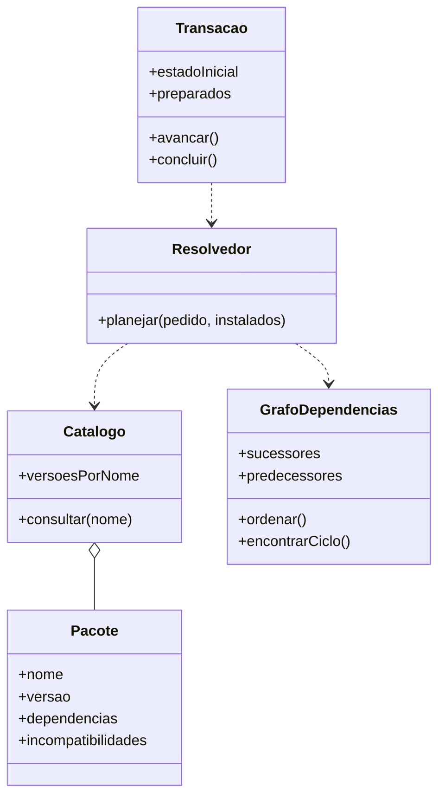

# Guia do projeto — DepGraph

## 1. Contexto e decisão de escopo

O grupo escolheu o **tema 9 — Gestão de Conflitos em Sistemas de Dependência**. A referência acadêmica é [TP.pdf](TP.pdf).

O tema permite dependências entre tarefas ou pacotes. O usuário esclareceu que deseja um sistema inspirado nos gerenciadores de pacotes Linux. Portanto, o foco atual é **resolver e visualizar dependências e conflitos de instalação de pacotes**, com versões, bibliotecas compartilhadas e estado instalado.

O primeiro exemplo de tarefas foi substituído. Não usar seus fluxos de compilar/testar/empacotar como apresentação principal do trabalho. O histórico foi preservado em [docs/prototipo-networkx/tarefas-historico.md](docs/prototipo-networkx/tarefas-historico.md).

Este arquivo distingue as exigências do professor das decisões do grupo. O enunciado exige ciclos, visualização e execução segura com ordenação topológica; o foco em pacotes e as regras de versão abaixo detalham a aplicação escolhida.

## 2. Estado atual

Há um protótipo exploratório em [prototypes/networkx_preview](prototypes/networkx_preview/), autorizado pelo usuário para visualização inicial. A entrada principal é:

```bash
python -m prototypes.networkx_preview
```

Ele usa NetworkX para grafos e Matplotlib para interface, com catálogo sintético de 27 nomes e 32 versões. O exemplo `desktop-suite` resulta em 17 pacotes, 26 dependências e 15 novas instalações sobre uma base de dois pacotes já instalados.

O código atual possui resolução de restrições por backtracking, verificação de conflitos, dependências ausentes e ciclos, plano topológico, atualização explícita, simulação de transação e análise de remoção. Os detalhes e as dez imagens estão no [guia do protótipo](docs/prototipo-networkx/README.md).

**Restrição acadêmica:** o PDF proíbe bibliotecas prontas para criação e processamento do grafo, como NetworkX, salvo comparação de desempenho. A autorização do usuário para explorar NetworkX não muda o enunciado. A entrega final precisa de estrutura e algoritmos de grafos próprios, salvo autorização do professor.

## 3. Requisitos acadêmicos obrigatórios

| Item | Exigência do PDF |
| --- | --- |
| Objetivo | Modelar, implementar e analisar um problema aplicado usando grafos como estrutura central. |
| Grupo | Até seis integrantes. |
| Linguagens | C/C++, Java ou Python. |
| Valor | 15 pontos. |
| Interface | Interface gráfica que apresente os resultados, sem limitação de framework de frontend. |
| Modelagem | A utilização de diagramas UML será avaliada. |
| Algoritmos | Demonstrar correção, analisar complexidade e discutir limitações. |
| Dados | O PDF orienta procurar bases em sites como Kaggle para execução e testes. |
| Versionamento | Repositório Git com histórico; commits individuais serão avaliados. |
| Relatório | LaTeX no template oficial SBC, obrigatório, com 12 a 15 páginas. |
| Conteúdo do relatório | Contextualização, modelagem, diagramas, resultados, telas, desempenho, conclusões e responsabilidades de cada integrante. |
| Apresentação | Presencial, oral, com demonstração e slides, duração de 10 minutos e participação de todos. |
| Vídeo | De 12 a 18 minutos, focado no funcionamento e nas funcionalidades produzidas por cada aluno. |
| Pacote | `.zip` com código-fonte da ferramenta, fontes do relatório `.tex` e PDF do relatório. Incluir recursos necessários para compilar. |
| Entrega | Cada integrante deve enviar sua própria cópia no Canvas; a entrega de colegas não substitui a obrigação. |
| Prazo | Cabeçalho informa 22/11, sem ano. O texto determina 23:59 e a data da tarefa no Canvas; confirmar ali o prazo. |
| Penalidades | Cópias serão zeradas. O PDF informa nota zero se faltar algum item obrigatório. |

Template indicado: [SBC Conferences Template](https://www.overleaf.com/latex/templates/sbc-conferences-template/blbxwjwzdngr).

O Canvas deve ser consultado para confirmar o envio do vídeo, slides e endereço do repositório, pois o PDF não detalha esses procedimentos. Todas as três etapas têm a mesma data de entrega. Variações do tema precisam de autorização do professor.

## 4. Integrantes

- Lucas Batista
- Caio Kfuri
- Arthur
- Rafael Abras
- David
- Joao Heleno

Não inventar sobrenomes, matrículas ou atribuições. Registrar responsabilidades reais quando forem distribuídas.

## 5. Problema aplicado e funcionalidades

O usuário informa um ou mais pacotes para instalar. A ferramenta consulta um catálogo com versões, dependências e incompatibilidades, considera o estado instalado e constrói um plano ou apresenta o motivo de bloqueio.

Funcionalidades do escopo:

1. Representar catálogo com múltiplas versões por pacote.
2. Representar pacotes instalados e suas versões.
3. Expandir dependências diretas e transitivas.
4. Combinar restrições impostas a uma mesma biblioteca por diferentes aplicativos.
5. Selecionar no máximo uma versão por nome, tentando alternativas quando necessário.
6. Detectar dependência ausente, incompatibilidade de versões, conflito de coexistência e ciclo como diagnósticos distintos.
7. Preservar dependentes já instalados ao planejar mudanças de versão.
8. Calcular a ordem de instalação dos pacotes selecionados.
9. Simular uma transação sem executar comandos reais.
10. Consultar dependentes transitivos e o impacto de uma eventual remoção.
11. Visualizar relações e explicar os resultados na interface.
12. Exportar informações para documentação e experimentos.

Um conflito não precisa ser um ciclo. Se dois pacotes exigem `libssl >=2.0` e `libssl <2.0`, a seleção de versões é impossível mesmo em um grafo acíclico.

## 6. Modelagem

### Catálogo e grafo selecionado

O catálogo associa cada nome a uma lista de versões. Cada versão contém nome, versão, descrição, dependências e incompatibilidades.

A busca produz uma atribuição `nome → versão`. O grafo dirigido do plano contém um vértice por nome selecionado, com a versão como atributo. A convenção é:

**A → B significa que B depende de A.**

Isso permite usar a ordenação topológica diretamente como ordem de instalação. No catálogo, o metadado de B lista A como dependência; a construção do grafo precisa preservar essa orientação.

As incompatibilidades são restrições separadas. Não inseri-las como dependências, nem tentar resolvê-las apenas com ordenação topológica. A interface pode desenhar uma linha de conflito sem incluí-la no grafo de precedência.

Arestas de dependência não têm pesos. Bibliotecas compartilhadas aparecem uma vez por nome, ainda que sejam exigidas por vários pacotes. Tarefas de execução e dependências opcionais não fazem parte da primeira versão de pacotes.

### Estruturas próprias da versão final

- Mapa de nomes para versões e metadados do catálogo.
- Mapa de nomes para versões instaladas.
- Mapa da atribuição de versões em uma tentativa de resolução.
- Listas de adjacência para dependentes e predecessores.
- Graus de entrada para ordenação topológica.
- Lista de requisitos por nome, com identificação de quem impôs cada restrição.
- Estado da transação e histórico de operações.

Não usar NetworkX no núcleo final. Estruturas básicas como mapas, conjuntos, listas e filas são adequadas para a implementação própria.

## 7. Algoritmos e correção

### Resolução de versões

Usar busca com retrocesso sobre candidatos, acumulando restrições e expandindo as dependências de cada versão escolhida. Descartar completamente as dependências de uma escolha abandonada. Verificar também as dependências e os conflitos dos pacotes instalados preservados.

O protótipo prefere versões mais altas e busca uma solução viável, sem garantir otimização global. Pacotes instalados ficam fixos, exceto os explicitamente incluídos no pedido. Documentar essa política; não apresentar seus bloqueios como impossibilidade sob toda política possível de atualização.

Ao atingir um limite de recursos, informar resultado inconclusivo. Não afirmar inexistência de solução sem concluir a busca dentro do escopo definido.

### Ordenação topológica

Na versão final, implementar Kahn com cópia dos graus de entrada e fila FIFO. Cada vértice só pode ser incluído quando não tiver predecessores pendentes. Se o total processado for menor que o número de vértices, não existe ordem completa.

Não alterar o grafo original durante a análise. Não confundir todos os vértices restantes com membros de um ciclo: alguns podem ser apenas dependentes bloqueados.

### Ciclos

Implementar DFS com estados branco/cinza/preto e reconstrução de um caminho fechado ao encontrar aresta para um vértice cinza. Percorrer todas as componentes. Mostrar pelo menos um ciclo real; enumerar todos os ciclos não é requisito da primeira versão.

A política didática rejeita ciclos para exigir precedência estrita. Gerenciadores Linux reais possuem regras adicionais; não equiparar essa simplificação à semântica completa de APT/dpkg.

### Dependentes e remoção

A partir do pacote analisado, percorrer seus sucessores para obter dependentes diretos e transitivos. Uma remoção em cascata exige ordem inversa da ordenação topológica do conjunto afetado. A funcionalidade atual apenas analisa o impacto; não remove pacotes.

### Transação simulada

Planejar e validar antes de avançar. Preparar um pacote por passo, garantindo que seus pré-requisitos tenham versão adequada no estado temporário. Atualizar o estado instalado somente ao concluir e validar a transação inteira.

Se o pedido ou o estado instalado mudar, exigir nova análise. Reiniciar uma preparação parcial descarta o progresso em memória. Não executar scripts de instalação reais.

### Complexidade

| Componente | Discussão esperada |
| --- | --- |
| Grafo por adjacência | Espaço `O(V + E)`. |
| Kahn com fila | Tempo `O(V + E)` e memória auxiliar `O(V)`. |
| DFS e reconstrução de um ciclo | Tempo `O(V + E)` e memória auxiliar `O(V)`. |
| Busca de dependentes | Tempo `O(V + E)` no pior caso. |
| Seleção por backtracking | Pode ser exponencial nas combinações de versões; medir candidatos explorados e definir limites. |
| Interface | Medir e discutir separadamente do tempo dos algoritmos. |

A linearidade de DFS e Kahn não implica linearidade da resolução de restrições. Justificar a correção por preservação de requisitos, descarte de escolhas inválidas e propriedade de precedência da ordem obtida.

## 8. Arquitetura e UML

O protótipo está dividido em `package_model.py` e `package_app.py`. O modelo contém catálogo, requisitos, pacotes, plano e sessão. A interface contém controles, visualização, diagnósticos e inspeção.

Para a versão final, separar catálogo, estrutura de grafo, resolução, algoritmos, persistência, transação e interface. O núcleo precisa funcionar sem abrir uma janela, permitindo testes e experimentos.



Esse diagrama é uma proposta conceitual para a versão final. Ajustá-lo à implementação e produzir também casos de uso e sequência de planejamento/execução. Exportar figuras legíveis para o relatório.

## 9. Dados e testes

O catálogo atual é sintético e está em `prototypes/networkx_preview/examples/pacotes.json`. Não apresentá-lo como base real de Linux. Pesquisar bases externas adequadas, registrar fonte, licença e transformação e justificar o uso de dados sintéticos quando necessário.

Casos essenciais:

- Fechamento transitivo com bibliotecas compartilhadas.
- Ordem que respeite todas as arestas, sem exigir uma única sequência possível.
- Versões numericamente comparadas e intervalos com várias condições.
- Versão instalada preservada e atualização explicitamente autorizada pelo pedido.
- Atualização que prejudicaria outro pacote instalado.
- Conflito declarado em apenas uma direção, verificado nos dois sentidos de seleção.
- Dependência ausente, laço e ciclo em componente desconexa.
- Escolha de versão alternativa sem dependências residuais da tentativa anterior.
- Limite de busca com resultado inconclusivo.
- Transação parcial sem mudança no estado instalado e confirmação do estado final.
- Pedido ou estado modificado após o planejamento.
- Dependentes afetados e ordem inversa de remoção.
- Validação de catálogo e renderização da interface.

A suíte atual combina 18 testes de pacotes com os 11 testes históricos de tarefas. Registrar os resultados efetivamente executados; não inventar métricas.

Nos experimentos, variar quantidade de pacotes, arestas, versões por nome, compartilhamento e tipos de conflito. Fixar sementes, repetir medições, registrar ambiente e dispersão. Separar resolução, algoritmos de grafo, leitura e desenho. Qualquer comparação com NetworkX deve ficar isolada do funcionamento final.

## 10. Etapas, equipe e relatório

### Etapa 1 — Modelagem e planejamento

Entregar descrição do problema, justificativa da modelagem e plano. Definir requisitos, política de versões, dados, UML, arquitetura e responsabilidades.

### Etapa 2 — Desenvolvimento

Entregar protótipo funcional com código versionado. Implementar núcleo próprio, integrar resolução, interface, persistência, testes e experimentos. A tecnologia da versão final pode ser Python com interface gráfica adequada; não tratar Tkinter como escolha obrigatória. O protótipo atual usa Matplotlib.

### Etapa 3 — Relatório e apresentação

Produzir relatório LaTeX/SBC de 12 a 15 páginas, apresentação presencial de 10 minutos, slides, vídeo de 12 a 18 minutos e demonstração. Todas as etapas têm a mesma data de entrega.

Dividir o trabalho entre modelagem/dados, estrutura de grafos, resolução/algoritmos, interface/transação, testes/experimentos e documentação/apresentação. Cada integrante deve ter contribuições identificáveis e commits próprios; todos participam da apresentação. Registrar os responsáveis reais no relatório.

Estrutura sugerida do relatório: introdução, fundamentação, modelagem/UML, arquitetura e implementação, correção e complexidade, metodologia experimental, resultados e telas, discussão/limitações, conclusão, contribuições e referências. O PDF não esclarece exceções na contagem de páginas para referências ou anexos; não presumir que estejam fora do limite.

## 11. Limites do modelo

O simulador não implementa o formato de pacotes Debian/RPM, comparação completa de versões de distribuições, arquiteturas, pacotes virtuais, alternativas com `|`, scripts de manutenção, conflitos de arquivos ou otimização de downloads. Não representa todas as regras de um gerenciador Linux real.

Versões seguem um a três componentes numéricos. Há uma versão por nome no estado selecionado. Não existe remoção automática para resolver incompatibilidades. Esses limites devem aparecer no relatório e ser considerados na interpretação dos resultados.

Referência de domínio: [relações entre pacotes na Debian Policy](https://www.debian.org/doc/debian-policy/ch-relationships.html).

## 12. Documentação e checklist

Centralizar documentos e imagens em [docs/](docs/README.md), em subpastas temáticas. Este arquivo e o PDF permanecem na raiz. Manter a documentação atual de pacotes separada do histórico de tarefas.

Antes de entregar:

- [ ] Núcleo próprio de grafos e algoritmos implementado e validado.
- [ ] Resolução de restrições consistente com a política documentada.
- [ ] Interface gráfica com exemplos válidos e diagnósticos de conflitos.
- [ ] Plano e simulação respeitando pré-requisitos e estado instalado.
- [ ] Dados, testes e experimentos reproduzíveis, com fontes e limites claros.
- [ ] Modelagem e UML coerentes com o código final.
- [ ] README com instruções reais de instalação, execução e testes.
- [ ] Histórico Git com contribuições individuais.
- [ ] Relatório SBC de 12 a 15 páginas, fontes e PDF conferidos.
- [ ] Responsabilidades reais de todos os integrantes registradas.
- [ ] Slides e apresentação de 10 minutos ensaiada com todos.
- [ ] Vídeo de 12 a 18 minutos sobre funcionalidades e contribuições.
- [ ] `.zip` com código e todos os arquivos do relatório.
- [ ] Envio dos demais materiais e prazo confirmados no Canvas.
- [ ] Entrega individual realizada por cada membro.

Não marcar funcionalidades planejadas como concluídas sem verificar código e evidências. Preservar as exigências do enunciado e as decisões atuais do usuário ao continuar o desenvolvimento.
