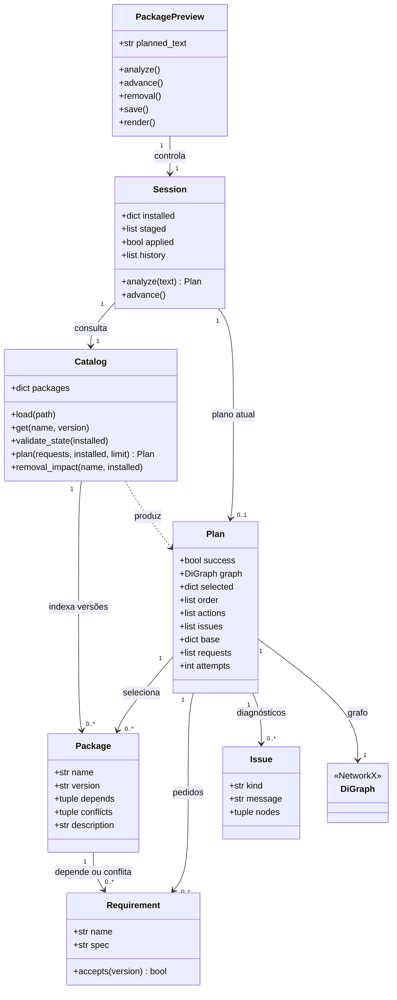
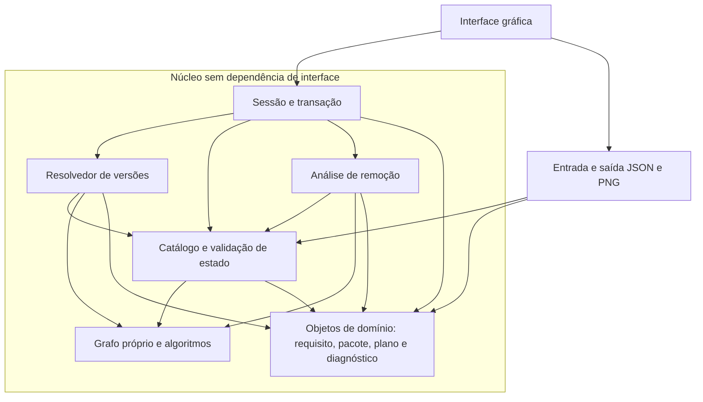
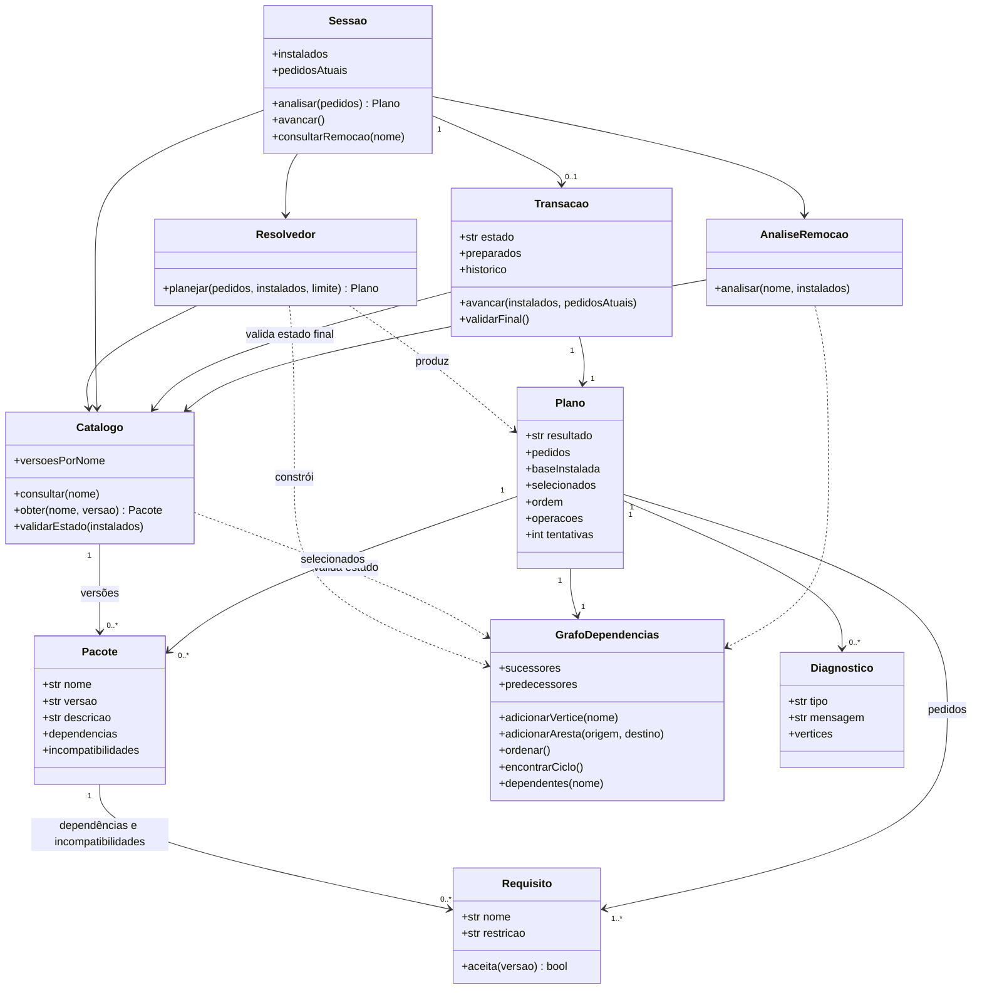

# Arquitetura e classes

As [modelagens principais](modelagens-principais.md) apresentam estas responsabilidades em figuras UML com fontes PlantUML, dividindo classes em domínio e núcleo. Os blocos Mermaid abaixo são vistas introdutórias; a galeria é a referência para as figuras do relatório.

## Classes existentes no protótipo

Esta vista resume os atributos e métodos relevantes de [package_model.py](../../prototypes/networkx_preview/package_model.py) e [package_app.py](../../prototypes/networkx_preview/package_app.py). Omite controles gráficos e funções auxiliares. `Catalog` concentra atualmente carga, validação, resolução e análise de remoção; `Session` gerencia a preparação e o estado instalado.

As relações indicam referências, sem afirmar exclusividade de propriedade. O mesmo pacote do catálogo pode ser referenciado por vários planos. O bloqueio após edição do pedido está atualmente em `PackagePreview.advance`; o núcleo verifica a alteração do estado instalado em `Session.advance`.

## Componentes propostos para a versão final

Status: proposta, ainda não implementada. Manter Python é uma escolha inicial coerente com o protótipo; o framework gráfico final permanece em aberto. As caixas abaixo representam responsabilidades, não diretórios já existentes. A vista usa fluxograma Mermaid, não notação formal de componentes UML.

Uma seta indica uso. A interface recebe resultados do núcleo e desenha vértices e arestas com recursos gráficos; o núcleo não importa Matplotlib nem NetworkX. A renderização final também precisa substituir as chamadas atuais a NetworkX para layout e desenho. Exportação recebe os resultados e a figura para escrever arquivos; não deve assumir decisões de resolução.

## Classes propostas

Os nomes abaixo são conceituais e podem ser ajustados na implementação. Os tipos de coleção foram simplificados para legibilidade. `Plano` registra cópias do pedido e do estado inicial; `Transacao` mantém a preparação separada do estado instalado da sessão.

`Plano.resultado` distingue `valido`, `bloqueado` e `inconclusivo`. Trata-se de uma proposta de representação mais explícita que o `success` e o diagnóstico `limite` do protótipo. Uma transação só pode avançar com resultado válido. Objetos de plano e suas coleções devem ser tratados como instantâneos após a análise, evitando que alterações externas mudem o significado do plano.

## Contratos e invariantes

| Elemento | Responsabilidade e invariante |
| --- | --- |
| Catálogo | Armazena múltiplas versões e valida metadados e estados; não executa a busca de solução. |
| Grafo | Um vértice por nome selecionado; A → B significa que B depende de A; sucessores e predecessores devem permanecer consistentes. |
| Resolvedor | Não altera os instalados; verifica todos os requisitos e conflitos; cada ramo possui suas próprias escolhas e dependências. |
| Plano | Ordem completa inclui pacotes preservados; operações incluem apenas nomes novos ou com versão diferente. Um plano de falha não pode ser executado. |
| Transação | Preparação parcial não altera instalados; valida o estado final antes da confirmação; rejeita pedido ou base diferentes dos instantâneos. |
| Sessão | Centraliza pedido e instalados e aplica o resultado validado; replanejamento descarta a transação parcial. |
| Análise de remoção | Usa o estado instalado; retorna dependentes e ordem inversa sem remover pacotes. |

Kahn deve usar cópia dos graus de entrada e fila FIFO. DFS usa estados branco/cinza/preto para reconstruir um ciclo real. A busca de dependentes percorre sucessores com conjunto de visitados. Os três procedimentos não alteram o grafo consultado e têm tempo O(V + E). Vértices que sobram no Kahn podem ser apenas dependentes de um ciclo; não devem ser todos rotulados como membros dele.

## Migração sugerida

1. Implementar e validar `GrafoDependencias` isoladamente.
2. Extrair o resolvedor de `Catalog.plan` e manter os cenários de referência.
3. Separar transação e sessão, centralizando a invalidação de pedido no núcleo.
4. Extrair leitura e exportação e conectar a interface ao núcleo novo.
5. Substituir layout e desenho que dependem de NetworkX; revisar imports de toda a aplicação final.
6. Atualizar estes diagramas conforme a estrutura realmente implementada.
