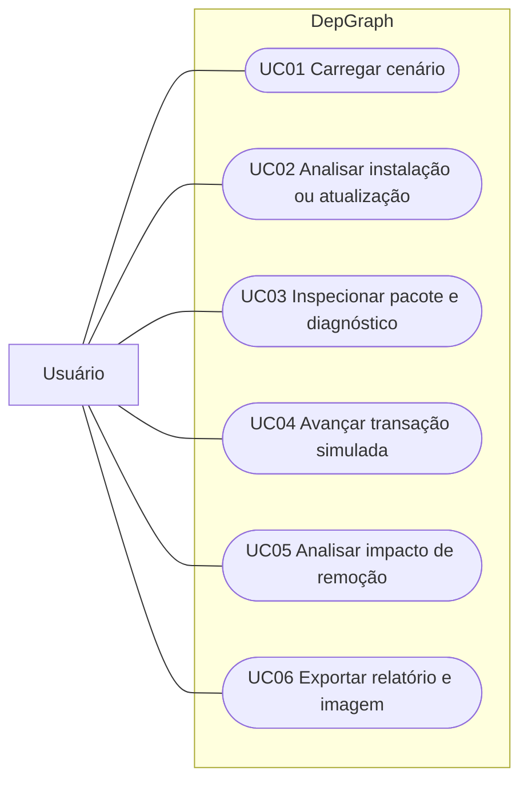

# Casos de uso

Status: funcionalidades do protótipo que devem ser preservadas na versão final. Relacionamentos abaixo descrevem objetivos do usuário, sem fixar tecnologia de interface.

A [vista UML de referência](modelagens-principais.md#1-casos-de-uso--o-que-o-usuário-pode-fazer) representa os mesmos seis objetivos com ator, elipses e fronteira do sistema. O bloco Mermaid a seguir é uma introdução simplificada.

## Visão geral

Representação simplificada em Mermaid; os agrupamentos indicam funcionalidades, sem semântica UML de `include` ou `extend`.

## UC01 — Carregar cenário

**Requisitos:** RF01, RF02. **Pré-condição:** catálogo válido disponível.

1. O usuário escolhe um cenário de demonstração.
2. A aplicação restaura a base instalada do cenário e descarta a sessão anterior.
3. Preenche o pedido, analisa e apresenta o resultado.

**Resultado:** nova sessão de demonstração. Catálogo ou estado inválido deve gerar erro explicativo. A restauração da base é própria da demonstração, não uma desinstalação real.

## UC02 — Analisar instalação ou atualização

**Requisitos:** RF02–RF07, RF10, RF14. **Pré-condição:** catálogo e estado instalado válidos.

1. O usuário informa nomes de pacotes e restrições opcionais e solicita análise.
2. A aplicação valida a entrada e registra pedido e estado usados no planejamento.
3. O resolvedor fixa os instalados não solicitados, expande dependências e tenta versões compatíveis.
4. Para uma atribuição completa, verifica a precedência e produz ordem topológica.
5. Mostra versões selecionadas, operações necessárias e grafo.

**Alternativas:** entrada inválida impede análise; falta de solução gera diagnóstico e bloqueia execução; limite de busca gera resultado inconclusivo. Um ciclo em uma tentativa permite tentar outra versão, quando houver candidatos.

**Resultado:** plano válido ou diagnóstico, sem alterar o estado instalado. Uma nova análise válida como entrada reinicia o progresso anterior. O plano pode conter zero operações se o pedido já estiver atendido.

## UC03 — Inspecionar pacote e diagnóstico

**Requisito:** RF12. **Pré-condição:** resultado de análise visível.

1. O usuário seleciona um vértice.
2. A aplicação mostra os metadados disponíveis, dependências e restrições relacionadas.
3. Em caso de falha, apresenta o diagnóstico associado ao resultado.

**Resultado:** consulta sem alteração de estado. Um nó de dependência ausente pode não ter metadados de pacote disponíveis.

## UC04 — Avançar transação simulada

**Requisitos:** RF08–RF10. **Pré-condição:** plano válido referente ao pedido e ao estado atuais.

1. O usuário solicita o próximo passo.
2. A aplicação verifica a validade do plano e os pré-requisitos da próxima operação no estado temporário.
3. Registra o pacote como preparado e atualiza o progresso.
4. Ao preparar a última operação, valida o estado final completo e confirma a transação em memória.

**Alternativas:** plano ausente, bloqueado ou desatualizado impede avanço; falha de pré-requisito ou validação impede confirmação; plano sem operações conclui sem alterar os instalados; avançar após conclusão não repete operações.

**Resultado:** durante preparação parcial, instalados intactos; após confirmação, estado final válido. A ação de reiniciar plano corresponde a uma nova análise, descartando a preparação parcial.

## UC05 — Analisar impacto de remoção

**Requisito:** RF11. **Pré-condição:** nome de um pacote instalado informado.

1. O usuário solicita a análise de impacto.
2. A aplicação percorre os dependentes no grafo do estado instalado.
3. Exibe o conjunto afetado e uma ordem de remoção que coloca dependentes antes das dependências.

**Alternativa:** nome não instalado gera erro explicativo.

**Resultado:** relatório de impacto; nenhum pacote é removido. O conjunto de dependentes exclui o pacote consultado; a ordem sugerida inclui esse pacote.

## UC06 — Exportar relatório e imagem

**Requisito:** RF13. **Pré-condição:** resultado de análise disponível.

1. O usuário solicita exportação.
2. A aplicação escreve o relatório JSON e uma imagem PNG da visualização.
3. Informa o destino ou o erro de escrita.

**Resultado:** arquivos para consulta e documentação. O relatório identifica pedido analisado e texto editado; exportar um resultado não autoriza executá-lo se estiver desatualizado. A exportação atual não garante atomicidade entre os dois arquivos: uma falha pode deixar apenas um deles gravado.
