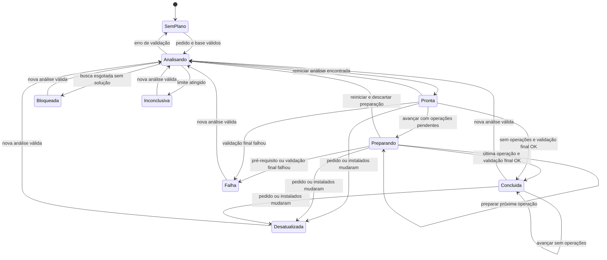
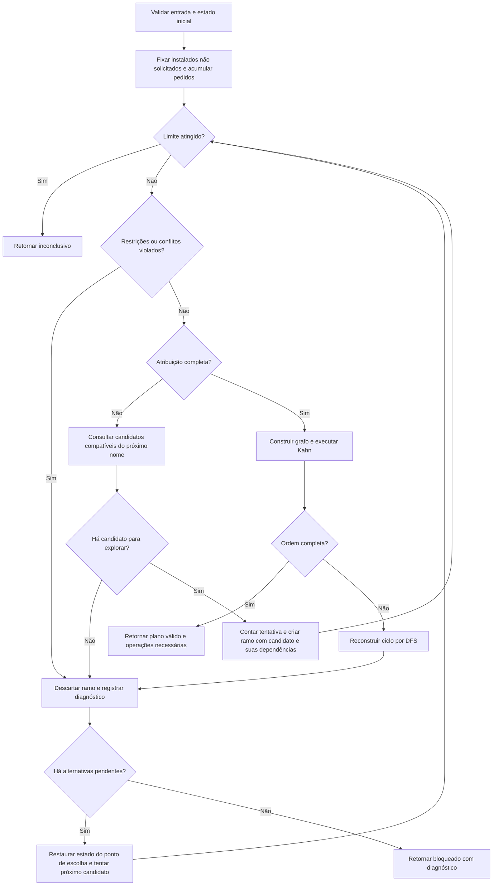

# Sequências, estados e atividade

Status: comportamento proposto para a arquitetura final, baseado no protótipo. Os participantes usam os nomes conceituais de [arquitetura.md](arquitetura.md). Os estados são explícitos nesta proposta; o protótipo usa combinações de `plan`, `staged`, `applied` e verificações na interface.

As [modelagens principais](modelagens-principais.md) refinam estas vistas com fontes PlantUML e figuras renderizadas. Incluem explicitamente a escolha após preparação, a validação final e o estado esperado após confirmação; são a referência para uso no relatório.

## Planejamento

```mermaid
sequenceDiagram
    actor U as Usuário
    participant I as Interface
    participant S as Sessao
    participant R as Resolvedor
    participant C as Catalogo
    participant G as GrafoDependencias
    U->>I: Analisar pedido
    I->>S: analisar(pedidos)
    S->>S: Validar sintaxe
    alt Entrada inválida
        S-->>I: Erro de entrada; execução indisponível para o pedido editado
    else Entrada válida
        S->>S: Descartar preparação e registrar pedido atual
        S->>R: planejar(pedidos, cópia dos instalados, limite)
        R->>C: validarEstado(instalados)
        alt Estado inicial inválido
            C-->>R: Erro de validação
            R-->>S: Erro; sem plano executável
        else Estado inicial válido
            loop Explorar candidatos enquanto necessário e dentro do limite
                R->>C: consultar(nome)
                C-->>R: Versões candidatas
                R->>R: Acumular requisitos e verificar conflitos
                opt Atribuição completa compatível
                    R->>G: Construir grafo e ordenar()
                    G-->>R: Ordem ou detecção de ciclo
                    opt Ciclo detectado
                        R->>G: encontrarCiclo()
                        G-->>R: Caminho fechado
                    end
                end
            end
            R-->>S: Plano válido, bloqueado ou inconclusivo
            S->>S: Registrar plano
            opt Resultado válido
                S->>S: Criar transação executável
            end
            S-->>I: Resultado e operações disponíveis
        end
        I-->>U: Grafo, plano ou diagnóstico
    end
```

Um ciclo invalida aquela atribuição de versões; o resolvedor ainda pode tentar uma alternativa. O laço termina ao encontrar uma solução, esgotar as alternativas ou atingir o limite. Se algum ramo necessário não foi explorado pelo limite, retornar inconclusivo em vez de concluir que não há solução.

## Preparação e confirmação

```mermaid
sequenceDiagram
    actor U as Usuário
    participant I as Interface
    participant S as Sessao
    participant T as Transacao
    participant C as Catalogo
    U->>I: Próximo pacote
    I->>S: avancar()
    S->>T: avancar(instalados, pedidosAtuais)
    T->>T: Comparar pedido e instalados com o plano
    alt Plano ausente ou não válido
        T-->>S: Bloquear e exigir nova análise
        S-->>I: Diagnóstico
    else Transação concluída, pedido e estado confirmado inalterados
        T-->>S: Sem operações pendentes
        S-->>I: Conclusão preservada
    else Pedido ou estado esperado alterados
        T-->>S: Desatualizada; exigir nova análise
        S-->>I: Diagnóstico
    else Plano atual e válido
        opt Existe operação pendente
            T->>T: Validar pré-requisitos no estado temporário
            T->>T: Registrar pacote preparado e histórico
        end
        alt Ainda há operações
            T-->>S: Progresso parcial
            S-->>I: Mostrar progresso; instalados preservados
        else Todas preparadas ou plano sem operações
            T->>C: validarEstado(estadoFinal)
            alt Estado final válido
                C-->>T: Validação concluída
                T-->>S: Estado final pronto para confirmação
                S->>S: Aplicar estado final e marcar conclusão na transação
                S->>S: Registrar o estado final como novo estado esperado
                S-->>I: Transação concluída
            else Validação falhou
                C-->>T: Erro
                T-->>S: Falha; confirmação bloqueada
                S-->>I: Erro; instalados preservados
            end
        end
    end
    I-->>U: Resultado do avanço
```

Uma falha de pré-requisito interrompe o avanço antes de registrar o pacote. A confirmação é uma substituição do estado em memória após validação completa, sem instalação real ou garantia de durabilidade em disco. O histórico de preparação não prova que o estado foi confirmado.

Após confirmação, a comparação usa o estado confirmado como esperado, em vez da base antiga do plano. A atualização interna da própria transação não deve gerar desatualização.

## Estados da transação



Somente `Pronta` e `Preparando` permitem executar operações. Em `Bloqueada`, `Inconclusiva`, `Desatualizada` e `Falha`, avançar retorna erro sem mudar instalados. Em `SemPlano`, também é necessária análise. Erro de sintaxe não cria nova transação: se houver um plano anterior e o pedido mudou, ele permanece indisponível para execução. Restaurar um cenário cria nova sessão a partir da base de demonstração.

## Atividade de resolução

Fluxograma de uma busca em profundidade com retrocesso. As alternativas pendentes pertencem à pilha da busca; voltar a uma alternativa restaura os requisitos e escolhas daquele ponto, descartando os dados do ramo abandonado.



O caminho de validação inicial que falha retorna erro antes da busca; foi omitido do fluxograma para manter o foco no backtracking. Uma implementação pode interromper toda a busca ao atingir o limite ou propagar ramos inconclusivos, mas não pode converter busca incompleta em prova de impossibilidade. Ausência de pacote e ausência de versão compatível geram diagnósticos distintos ao descartar um ramo.
