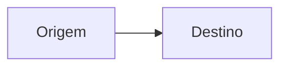
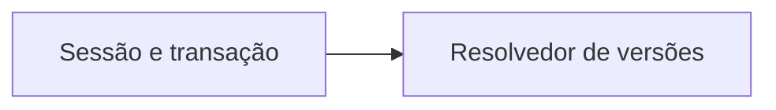
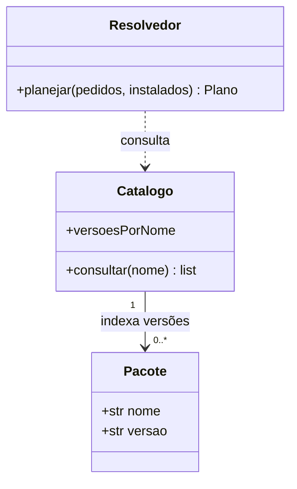
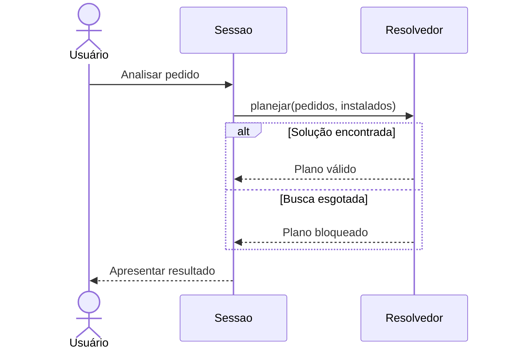
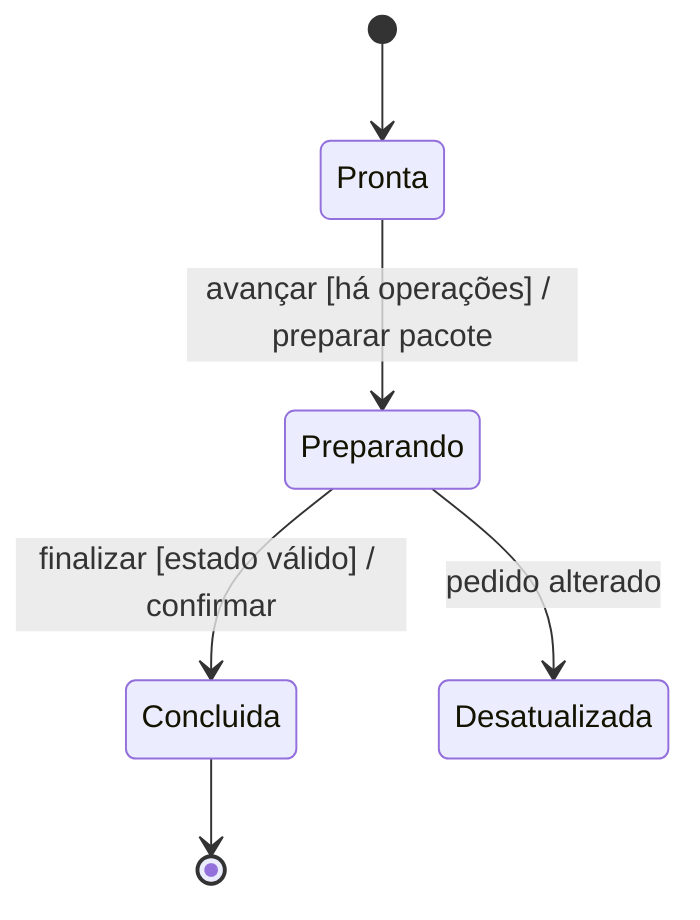

# Guia de formatação e notação da modelagem

Este guia explica como escrever, ler e revisar os documentos e diagramas do DepGraph. Abrange a notação utilizada nesta pasta e as convenções adotadas pelo projeto; não pretende reproduzir toda a especificação UML nem todos os recursos do Mermaid.

## 1. Markdown, Mermaid e UML

São três camadas diferentes:

| Camada | Função no projeto |
| --- | --- |
| Markdown (`.md`) | Organiza títulos, explicações, tabelas, links e blocos de código. |
| Mermaid | Descreve diagramas em texto e permite renderizá-los. |
| PlantUML | Escreve as fontes `.puml` do conjunto principal e gera figuras PNG/SVG. |
| UML | Define conceitos de modelagem e sua semântica; não é um formato de arquivo Mermaid. |

Um diagrama renderizar corretamente não prova que a modelagem esteja correta. Por exemplo, uma seta pode ser sintaticamente válida e apontar para a classe errada.

Nas vistas introdutórias desta pasta, `classDiagram`, `sequenceDiagram` e `stateDiagram-v2` representam classes, sequência e estados. Os blocos `flowchart` de casos de uso, componentes e atividade são simplificados. As [principais modelagens](modelagens-principais.md) usam fontes PlantUML para representar esses tipos com notação UML e são a referência para as figuras do relatório.

## 2. Organização e formato dos documentos

Salvar documentos em `docs/modelagem/`, usando nomes em minúsculas, separados por hífen, sem espaços ou acentos. O texto deve usar português com acentuação normal e codificação UTF-8. Manter links relativos para funcionar também fora da máquina de um integrante.

Usar um título principal `#`, seções `##` e subseções `###`. Não saltar níveis sem motivo. Separar títulos, parágrafos, listas, tabelas e blocos por linhas em branco. Listas numeradas representam passos; listas com hífen representam itens sem sequência obrigatória. Tabelas devem comparar informações da mesma natureza.

Modelo para uma nova vista:

````markdown
# Nome da vista

Status: proposta para a versão final.

## Objetivo e escopo

Qual pergunta o diagrama responde e quais detalhes foram omitidos.

## Diagrama



## Leitura e regras

Explique o significado das setas, condições, invariantes e limitações.

## Rastreabilidade

Requisitos relacionados e links para código ou outras vistas.
````

A cerca externa com quatro crases acima permite mostrar literalmente um bloco interno de três crases. No documento real, usar apenas a cerca de três crases com o identificador `mermaid` para renderizar o desenho. A integração é descrita na [documentação do GitHub](https://docs.github.com/en/get-started/writing-on-github/working-with-advanced-formatting/creating-diagrams).

Identificar cada vista como **existente**, **proposta** ou **histórica**. Informar omissões, como métodos auxiliares da interface. Não apresentar nomes conceituais da versão final como classes já implementadas.

## 3. Convenções comuns aos diagramas

- Indentar o conteúdo com quatro espaços para facilitar a leitura do código-fonte; a indentação não substitui o fechamento de blocos.
- Usar identificadores simples e estáveis, como `Catalogo`, `S` ou `Preparando`. Colocar nomes completos e acentos nos rótulos.
- Declarar relações em linhas separadas e usar comentários `%%` quando for necessário explicar a sintaxe sem aparecer na figura.
- Preferir texto entre aspas em rótulos com pontuação ou caracteres que possam ser interpretados como sintaxe.
- Não depender apenas de cor: estados, decisões e relações devem ter nomes legíveis.
- Informar o significado das setas em cada vista. A mesma sequência de caracteres pode ter semântica diferente em outro tipo de diagrama.

Exemplo de comentário e rótulo:



## 4. Diagrama de classes

A sintaxe começa com `classDiagram`. Dentro de uma classe, membros sem parênteses representam atributos e membros com parênteses representam operações. No Mermaid, escrever o tipo de retorno depois de `)`; na notação UML textual convencional, costuma-se escrever `operacao(parametro: Tipo): Retorno`. Não misturar as duas formas sem verificar a renderização. Consulte a [referência de classes do Mermaid](https://mermaid.js.org/syntax/classDiagram.html).



O exemplo é didático: `consultar` retorna uma coleção de versões; sua assinatura definitiva deve acompanhar o código. Os diagramas conceituais existentes omitem alguns tipos para priorizar responsabilidades.

### Visibilidade e anotações

| Símbolo | Leitura |
| --- | --- |
| `+` | Público. |
| `-` | Privado. |
| `#` | Protegido. |
| `~` | Visibilidade de pacote. |
| `<<interface>>` | Anotação de interface, quando esse contrato existir. |
| `<<NetworkX>>` | Anotação explicativa local de origem externa; não é um estereótipo UML padrão definido pelo projeto. |

Em Python, `+` representa a intenção de API pública da modelagem, não um modificador imposto pela linguagem. Não marcar atributos como privados só para tornar o desenho mais detalhado.

### Relações e multiplicidades

| Sintaxe em `classDiagram` | Significado pretendido |
| --- | --- |
| `A --> B` | Associação navegável de A para B; A mantém acesso a B. |
| `A ..> B` | Dependência: A usa B, por exemplo em uma chamada ou criação. |
| `A -- B` | Associação sem direção de navegação explicitada. |
| `A <|-- B` | Generalização: B especializa A. |
| `A <|.. B` | Realização: B realiza o contrato A. |
| `A o-- B` | Agregação compartilhada; losango vazio no lado do todo A. |
| `A *-- B` | Composição; losango preenchido no lado do composto A. |

Não usar agregação ou composição apenas porque existe uma lista de objetos. É preciso justificar a semântica de todo/parte e, na composição, o controle de existência e a exclusividade pertinentes. As vistas atuais preferem associações para não presumir essas garantias.

| Multiplicidade | Quantidade de instâncias naquela extremidade |
| --- | --- |
| `1` | Exatamente uma. |
| `0..1` | Nenhuma ou uma. |
| `0..*` ou `*` | Nenhuma ou várias. |
| `1..*` | Uma ou várias. |

Em `Catalogo "1" --> "0..*" Pacote`, um catálogo se relaciona com zero ou mais versões de pacote; na direção inversa, a vista restringe cada objeto de pacote a um catálogo. Essa segunda afirmação também precisa ser verdadeira no escopo modelado. Quando uma quantidade não foi definida, omiti-la e explicar a omissão, em vez de inventar um número.

### Particularidades do DepGraph

Uma instância de `Pacote` representa uma versão do catálogo. Já o grafo de uma solução contém um vértice por nome e associa a ele a versão selecionada. São níveis diferentes de representação.

A seta de associação `Resolvedor --> Catalogo` significa acesso entre objetos. A aresta **A → B do grafo de dependências** significa que B depende de A. Não deduzir a orientação do grafo pela direção das associações entre classes.

## 5. Diagrama de sequência

`sequenceDiagram` descreve mensagens entre participantes. A leitura é de cima para baixo. Os nomes depois de `as` são rótulos visuais; os identificadores anteriores são usados nas mensagens. Sintaxe e tipos de mensagens estão na [referência de sequência](https://mermaid.js.org/syntax/sequenceDiagram.html).



| Construção | Uso adotado |
| --- | --- |
| `actor` | Ator externo. |
| `participant` | Objeto ou responsabilidade participante. |
| `A->>B: mensagem` | Solicitação ou chamada. |
| `B-->>A: resultado` | Resposta, desenhada com linha tracejada. |
| `A->>A: ação` | Processamento interno. |
| `alt` / `else` / `end` | Alternativas condicionais. |
| `opt` / `end` | Comportamento opcional. |
| `loop` / `end` | Repetição. |

Cada fragmento deve fechar com seu próprio `end`, inclusive quando estiver aninhado. Uma resposta não significa sucesso: pode conter erro ou diagnóstico. `->>` é a convenção visual usada nestes documentos, sem a pretensão de codificar todos os detalhes de mensagens síncronas da UML formal.

Mostrar caminhos de falha relevantes ao contrato, como plano desatualizado e validação final recusada. Um bloco de repetição precisa ter condição de saída explicada. A sequência do resolvedor deve permitir tentar outra versão após um ciclo, e não tratar todo ciclo de uma tentativa como falha definitiva do pedido.

## 6. Diagrama de estados

`stateDiagram-v2` descreve situações de um mesmo objeto e transições entre elas. Não é uma lista de chamadas entre classes. A [referência de estados do Mermaid](https://mermaid.js.org/syntax/stateDiagram.html) documenta a sintaxe.



`[*]` na origem indica início; no destino, término. `Origem --> Destino: rótulo` define uma transição. No rótulo, adotar `evento [guarda] / efeito` quando isso ajudar: o evento dispara, a guarda autoriza e o efeito é executado. O Mermaid apresenta esse rótulo como texto; não verifica a lógica da guarda.

Uma transição para o próprio estado representa retorno a ele após o evento. Usar nomes de situações, como `Preparando`, e não confundir estado com ação, como `validarEstado()`.

O exemplo acima é mínimo. Na sessão real, `Concluida` permite novas análises; por isso o diagrama principal não a liga ao término. A ausência de estado final é intencional em uma sessão que pode continuar sendo usada.

Para cada estado do DepGraph, esclarecer quais comandos são permitidos e quais preservam os instalados. `Bloqueada` significa busca concluída sem solução na política adotada; `Inconclusiva` significa busca incompleta. Esses resultados não podem ser unidos.

## 7. Fluxogramas: atividade, casos de uso e componentes

A declaração `flowchart LR` organiza da esquerda para a direita; `flowchart TD` ou `TB`, de cima para baixo. As direções controlam a apresentação, não o significado da relação. A [referência de fluxogramas](https://mermaid.js.org/syntax/flowchart.html) descreve as formas e conexões.

| Código | Forma ou conexão |
| --- | --- |
| `A["Processar pedido"]` | Retângulo. |
| `B{"Plano válido?"}` | Losango de decisão. |
| `C(["Analisar instalação"])` | Forma arredondada usada para objetivo do usuário. |
| `A --> B` | Conexão direcionada. |
| `A --- B` | Conexão sem seta. |
| `B -->|Sim| C` | Conexão com rótulo. |
| `subgraph S["DepGraph"]` ... `end` | Agrupamento com identificador e título. |

### Fluxo de atividade

Usar verbos nas ações e perguntas nas decisões. Rotular saídas como `Sim` e `Não`, ou com condições que cubram as possibilidades relevantes. Explicar o retorno do backtracking: quais escolhas são restauradas e quais dependências são descartadas. Um fluxo de controle não representa arestas do grafo de pacotes.

Para converter a vista em diagrama UML formal de atividades, revisar nós de ação, decisões/mesclas, nós iniciais e finais e guardas. Não inferir paralelismo por duas saídas: bifurcação e sincronização têm semântica própria.

### Casos de uso

O agrupamento `DepGraph` delimita a aplicação. `Usuário` fica fora; funcionalidades ficam dentro e se ligam ao ator por linha sem seta. A forma arredondada atual é uma convenção visual simplificada.

Para UML formal, usar ator, elipses de casos de uso e fronteira do sistema. Se houver reutilização obrigatória, uma relação `«include»` parte do caso que inclui em direção ao incluído. Uma relação `«extend»` parte do caso de extensão em direção ao caso base e exige condições/pontos de extensão adequados. Não criar essas relações apenas porque dois casos ocorrem em sequência; os diagramas atuais não as utilizam.

### Componentes

Na vista atual, uma seta de A para B significa que A usa B, e cada caixa representa uma responsabilidade. Ela não indica necessariamente chamada de função, importação Python ou fluxo de dados. Para UML formal de componentes, identificar componentes, interfaces fornecidas/requeridas e dependências efetivas. Uma caixa de fluxograma, sozinha, não declara uma interface UML.

## 8. Formato dos requisitos e casos de uso

### Requisitos

Usar identificadores estáveis:

| Prefixo | Conteúdo |
| --- | --- |
| `RF` | Requisito funcional, como planejar uma instalação. |
| `RD` | Regra do domínio, como uma versão por nome. |
| `RN` | Requisito técnico ou acadêmico, como núcleo próprio de grafos. |
| `UC` | Caso de uso associado a um objetivo do usuário. |

Esses prefixos são convenção local, não sintaxe UML. Preservar os números existentes ao inserir novos itens. Não reutilizar um ID removido para outro significado; registrar a alteração.

Cada requisito deve expressar comportamento verificável e indicar sua situação. Separar aquilo que deve acontecer da evidência de que aconteceu. Exemplo do projeto: RF08 exige preparação parcial sem alterar instalados; um teste deve comparar o estado antes e após um avanço intermediário.

### Casos de uso

Adotar o seguinte roteiro, como já aplicado em [casos-de-uso.md](casos-de-uso.md):

1. **ID e objetivo:** `UC04 — Avançar transação simulada`.
2. **Requisitos:** IDs relacionados.
3. **Pré-condições:** o que deve valer antes do início.
4. **Fluxo principal:** passos numerados entre usuário e aplicação.
5. **Alternativas e erros:** condições e resultados dos desvios.
6. **Resultado:** pós-condições, incluindo garantias em caso de falha.

Evitar nomes de botões e bibliotecas quando não forem essenciais ao objetivo. Se uma alternativa mudar o estado instalado, isso deve estar explícito. No DepGraph, analisar remoção nunca remove pacotes.

## 9. Consistência entre as vistas

Antes de aceitar uma alteração, conferir:

1. O requisito existe e seu resultado pode ser observado.
2. O caso de uso expressa o objetivo e as falhas relevantes.
3. A classe ou componente tem responsabilidade por esse comportamento.
4. A sequência chama operações coerentes com essas responsabilidades.
5. As transições permitem o comportamento apenas nos estados adequados.
6. A implementação e os testes sustentam o que a vista marca como existente.

Exemplo de rastreamento: **RF10 → UC04 → Sessao/Transacao → sequência de preparação → estado Desatualizada**. A regra é impedir execução quando pedido ou base mudarem. No protótipo, parte dessa responsabilidade ainda está na interface; isso deve continuar indicado até a migração real.

Não exigir que toda classe apareça em toda sequência. As vistas têm escopos diferentes, mas não podem se contradizer. Os exemplos didáticos deste guia também não substituem os diagramas completos de arquitetura e comportamento.

## 10. Renderização, revisão e exportação

1. Editar o `.md` preservando a fonte Mermaid.
2. Abrir em um renderizador que suporte Mermaid ou copiar somente o conteúdo interno do bloco para o [Mermaid Live Editor](https://mermaid.live/).
3. Renderizar cada bloco alterado no ambiente de destino. GitHub, editores e ferramentas de exportação podem usar versões diferentes; não presumir suporte idêntico.
4. Conferir relações, rótulos, multiplicidades, condições e caminhos de falha com a documentação e o código.
5. Conferir os links relativos e executar `git diff --check` na raiz para detectar problemas de espaços no diff. Esse comando não valida Mermaid nem UML.
6. Exportar a figura no formato compatível com o fluxo LaTeX escolhido, preservando legibilidade, proporção e tamanho de fonte. Para figuras vetoriais, verificar a conversão ou suporte a PDF/SVG; PNG deve ter resolução suficiente no tamanho final.
7. Inserir legenda e referência à figura no relatório e guardar sua fonte editável no repositório. Informar o caráter proposto ou existente da arquitetura na legenda ou no texto próximo.

Ao registrar validação, especificar o que foi feito: revisão textual, verificação de links, parsing ou renderização visual. Uma conferência de blocos de crases não permite afirmar que os diagramas foram renderizados com sucesso.

## 11. Notação PlantUML do conjunto principal

As fontes estão em [uml/](uml/) e as imagens geradas em [imagens/](imagens/). Cada diagrama começa com `@startuml`, termina com `@enduml` e inclui `!include estilo.puml`. Esse arquivo compartilha fonte, cores e configuração de layout; não é uma figura independente. Comentários de linha começam com apóstrofo.

| Construção nas fontes | Significado |
| --- | --- |
| `class Catalogo { ... }` | Classe com atributos e operações. |
| `+nome: str` | Atributo público com tipo. |
| `+consultar(nome: str): lista<Pacote>` | Operação com parâmetro e retorno na forma usada nestas fontes. |
| `enum ResultadoPlano { ... }` | Enumeração de resultados possíveis. |
| `A --> "0..*" B` | Associação navegável, com multiplicidade no destino. |
| `A ..> B` | Dependência de uso. |
| `actor "Usuário" as U` | Ator com identificador U. |
| `usecase "Analisar pedido" as UC` | Caso de uso representado por elipse. |
| `rectangle "DepGraph" { ... }` | Fronteira do sistema na vista de casos de uso. |
| `component "Catálogo" as C` | Componente lógico. |
| `package "Núcleo" { ... }` | Agrupamento de elementos. |
| `A -> B : pedido` | Chamada na sequência. |
| `B --> A : resultado` | Resposta tracejada na sequência; não confundir com associação de classes. |
| `state Disponivel { ... }` | Estado composto. |
| `state Escolha <<choice>>` | Pseudestado de escolha, com guardas nas saídas. |
| `:Validar entrada;` | Ação em atividade. |
| `start` e `stop` | Início e término da atividade. |

Em sequência, `alt`, `else`, `opt`, `loop` e `end` delimitam fragmentos. `boundary`, `control` e `entity` distinguem visualmente interface, coordenação e dados, sem declarar classes adicionais na arquitetura. Na atividade, `if (...) then (...)`, `else (...)`, `endif`, `while (...) is (...)` e `endwhile (...)` organizam decisões e repetições. Essa sintaxe não é intercambiável com `flowchart` do Mermaid.

Não editar manualmente PNG ou SVG para mudar uma regra: editar a fonte `.puml`, regenerar e conferir a figura. A versão do renderizador, o comando e o resumo de cada diagrama estão em [modelagens-principais.md](modelagens-principais.md). A fonte principal é a documentação oficial de [classes](https://plantuml.com/class-diagram), [casos de uso](https://plantuml.com/use-case-diagram) e [atividade](https://plantuml.com/activity-diagram-beta) do PlantUML.

### Conferência visual de cardinalidades

As vistas de classes sobrescrevem o layout compartilhado com `!pragma layout elk`. Na revisão, esse mecanismo separou as setas e os rótulos melhor que o Smetana. A configuração é de apresentação e não muda as associações nem suas multiplicidades. Os mecanismos disponíveis estão na [referência de layouts do PlantUML](https://plantuml.com/layout-engines).

Conferir cada extremidade ampliando a figura: o número deve estar próximo da classe correta, sem ser atravessado por outra seta, sobrepor outro número ou tocar o texto da classe. Conferir também os nomes dos papéis entre classes ligadas por mais de uma relação. Se houver problema, ajustar o layout, o espaçamento ou a divisão da vista; não apagar uma multiplicidade necessária para limpar o desenho.

Nas vistas de componentes e estados, `skinparam packageStyle rectangle` evita abas nas caixas de agrupamento. Nos estados, `skinparam packageTitleAlignment right` afasta os títulos das setas de entrada e `hide empty description` elimina compartimentos vazios. Essas opções não alteram as transições. Após qualquer troca de layout, revisar novamente todas as relações, pois um renderizador pode suportar apenas parte dos recursos da linguagem.

## 12. Referências e alcance

As regras de organização, IDs e rastreabilidade deste guia são convenções do DepGraph. A sintaxe deve seguir as referências oficiais de [classes](https://mermaid.js.org/syntax/classDiagram.html), [sequência](https://mermaid.js.org/syntax/sequenceDiagram.html), [estados](https://mermaid.js.org/syntax/stateDiagram.html) e [fluxogramas](https://mermaid.js.org/syntax/flowchart.html). Para semântica UML formal, a referência é a [especificação UML 2.5.1 da OMG](https://www.omg.org/spec/UML/2.5.1).

Essas fontes foram consultadas na elaboração do guia. Não foi fixada uma versão de renderizador no projeto; antes de adotar uma construção nova, conferir compatibilidade com a ferramenta usada pelo grupo.
