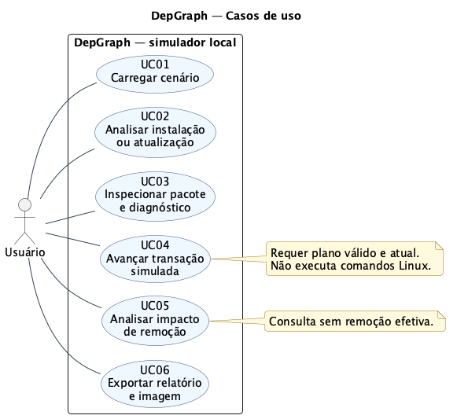
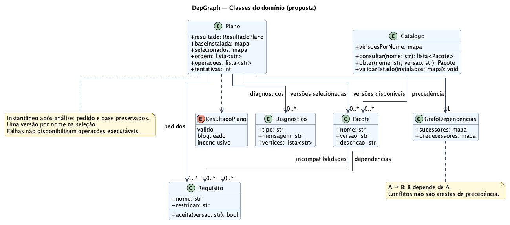
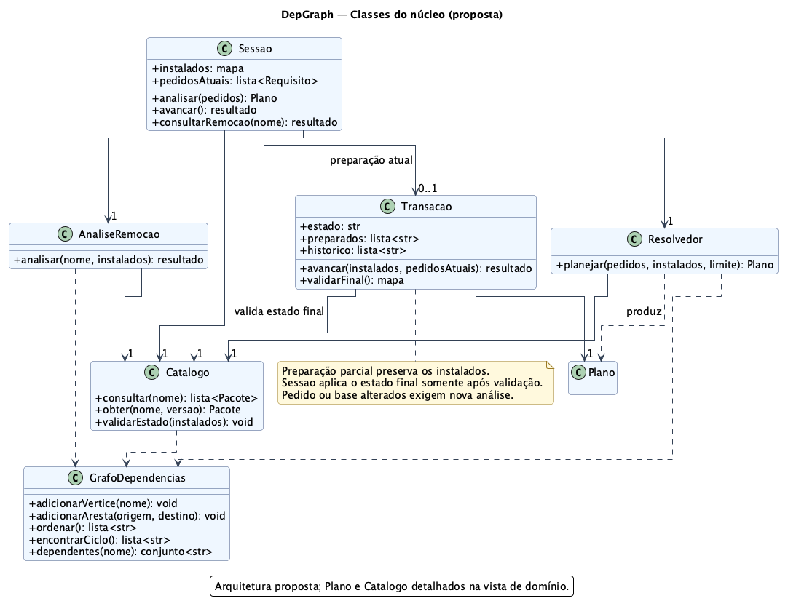
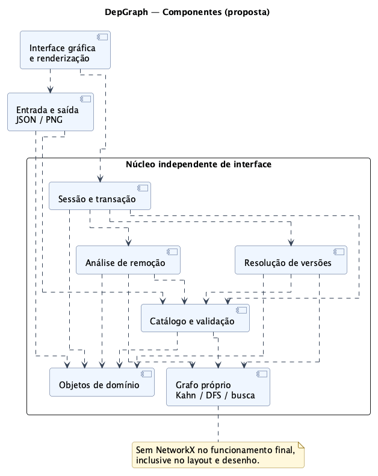
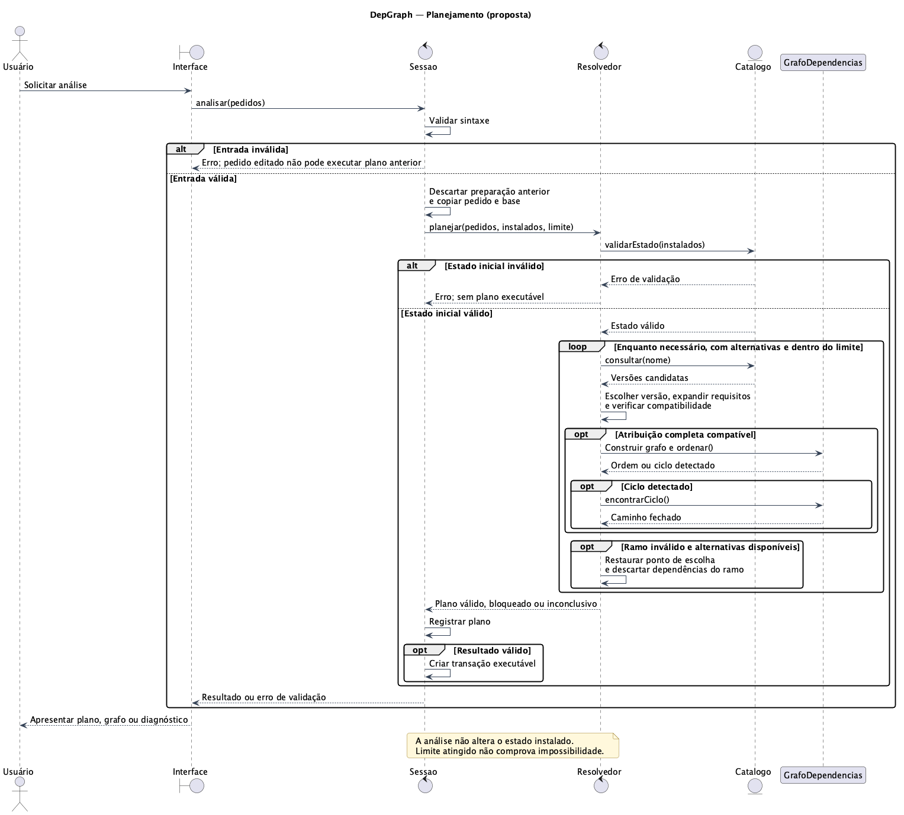
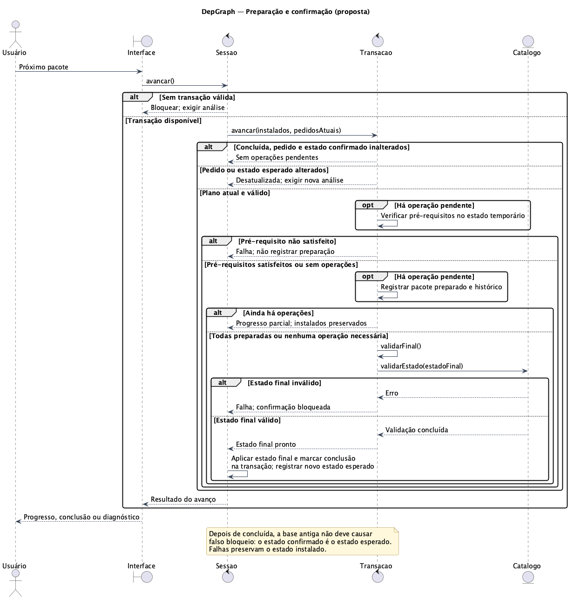
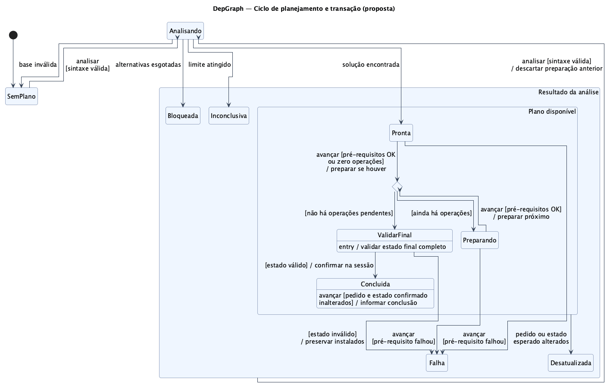
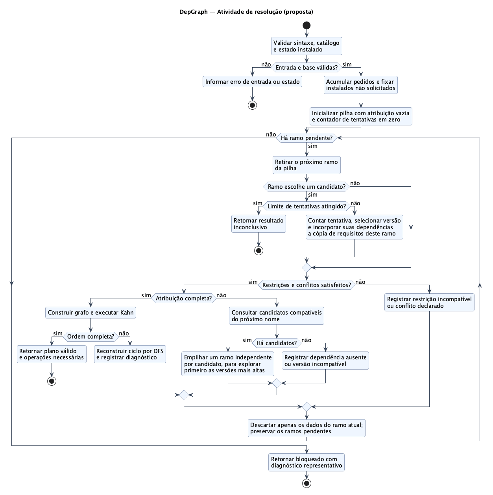

# Principais modelagens do DepGraph

Este conjunto apresenta as funcionalidades atuais e a arquitetura proposta para a versão acadêmica com grafos próprios. As figuras usam notação UML produzida com PlantUML; não são capturas do código final. Os nomes conceituais seguem [arquitetura.md](arquitetura.md).

As fontes em [uml/](uml/) são a referência editável destas figuras. Os blocos Mermaid dos documentos anteriores servem como vistas introdutórias; para revisão e inclusão no relatório, usar este conjunto, que detalha também as condições de confirmação e os caminhos de erro. Ao alterar regras, atualizar as explicações e fontes afetadas e regenerar as imagens.

A [revisão dos oito diagramas](revisao-dos-diagramas.md) registra a conferência de cardinalidades, regras e legibilidade, com as correções realizadas.

## 1. Casos de uso — o que o usuário pode fazer



[Fonte PlantUML](uml/01-casos-de-uso.puml) · [Figura vetorial SVG](imagens/01-casos-de-uso.svg)

O único ator externo é o usuário. A fronteira contém os seis objetivos descritos em [casos-de-uso.md](casos-de-uso.md). Catálogo, resolvedor e estado instalado são partes do sistema, não atores. Não foram adicionadas relações `include` ou `extend`, pois a ordem de execução de dois objetivos não justifica essas relações.

**Situação:** funcionalidades do protótipo a preservar. **Requisitos:** RF01–RF14, distribuídos nos seis casos de uso. Pré-condições e alternativas permanecem na especificação textual dos casos.

## 2. Classes do domínio — quais informações são representadas



[Fonte PlantUML](uml/02-classes-dominio.puml) · [Figura vetorial SVG](imagens/02-classes-dominio.svg)

`Pacote` representa uma versão disponível, com requisitos separados de dependência e incompatibilidade. `Catalogo` indexa as versões. `Plano` referencia os pedidos, versões selecionadas, grafo de precedência e diagnósticos; mantém uma cópia da base instalada e a lista de operações necessárias.

`ResultadoPlano` explicita três resultados: válido, bloqueado e inconclusivo. Essa enumeração é proposta para a versão final; o protótipo usa `success` e um diagnóstico de limite. Um grafo parcial pode existir em um resultado de falha para explicar o problema, sem autorizar a execução.

**Situação:** proposta. **Requisitos:** RF01–RF07 e RF14. As multiplicidades escritas restringem as extremidades de destino; multiplicidades inversas não especificadas não devem ser interpretadas como exclusividade. Associações não afirmam composição ou controle exclusivo de ciclo de vida. Tipos como `mapa` e `lista` são abreviações conceituais.

## 3. Classes do núcleo — quem executa cada responsabilidade



[Fonte PlantUML](uml/03-classes-nucleo.puml) · [Figura vetorial SVG](imagens/03-classes-nucleo.svg)

`Sessao` coordena os comandos e mantém os instalados. `Resolvedor` busca uma atribuição de versões sem alterar o estado. `Transacao` prepara operações vinculadas a um plano. Após validação integral, a sessão aplica o estado final. `AnaliseRemocao` consulta dependentes sem remover pacotes. `GrafoDependencias` implementa adjacência, Kahn, DFS e busca de dependentes.

`Catalogo` e `Plano` são as mesmas classes da vista anterior, com detalhes omitidos. As setas contínuas representam acesso por associação; as tracejadas representam dependência de uso. O catálogo usa o grafo para validar estados, enquanto o resolvedor o constrói para analisar as escolhas.

**Situação:** proposta de separação do atual `Catalog` e `Session`. **Requisitos:** RF03–RF11, RF14, RN01–RN03. As assinaturas são contratos conceituais, não uma API final já implementada.

## 4. Componentes — como a aplicação será dividida



[Fonte PlantUML](uml/04-componentes.puml) · [Figura vetorial SVG](imagens/04-componentes.svg)

A interface envia comandos ao núcleo e usa entrada/saída para carregar e exportar arquivos. O núcleo não depende da interface. Os componentes são responsabilidades lógicas, não processos nem diretórios já criados. Todas as setas são dependências de uso; interfaces fornecidas/requeridas não foram inventadas nesta etapa.

A migração precisa retirar NetworkX tanto do processamento quanto do layout e desenho da versão final. A camada gráfica pode utilizar recursos de desenho sem executar os algoritmos de domínio.

**Situação:** proposta. **Requisitos:** RF01, RF12–RF13, RN01–RN02.

## 5. Sequência de planejamento — como um pedido vira plano



[Fonte PlantUML](uml/05-sequencia-planejamento.puml) · [Figura vetorial SVG](imagens/05-sequencia-planejamento.svg)

A sessão valida a entrada e o resolvedor verifica a base, consulta candidatos e explora versões. Uma atribuição completa compatível permite construir o grafo e tentar a ordem topológica. Se houver ciclo, a DFS obtém um caminho real para o diagnóstico; outras versões ainda podem ser tentadas. Ao abandonar um ramo, suas dependências são descartadas.

O laço resume a busca em profundidade, sem representar cada chamada recursiva. Uma solução encerra a busca; esgotamento produz bloqueio; limite atingido antes da conclusão produz resultado inconclusivo. Todos os caminhos preservam os instalados.

A sessão registra qualquer resultado de análise, mas cria uma transação executável somente quando o plano é válido.

**Situação:** proposta de colaboração entre as classes finais. **Requisitos:** RF02–RF07, RF10 e RF14.

## 6. Sequência de transação — quando o estado pode mudar



[Fonte PlantUML](uml/06-sequencia-transacao.puml) · [Figura vetorial SVG](imagens/06-sequencia-transacao.svg)

Cada avanço prepara no máximo uma operação. Os pré-requisitos são conferidos no estado temporário composto pelos instalados e pelas versões já preparadas. Uma falha impede a confirmação. Ao terminar todas as operações, o catálogo valida o estado completo antes de a sessão aplicá-lo.

**Casos de borda modelados:** plano ausente ou não válido; pedido ou base alterados; pré-requisito não satisfeito; validação final recusada; pedido já atendido sem operações; novo avanço após conclusão. Depois da confirmação, o estado final passa a ser o esperado, para que a atualização feita pela própria transação não gere um falso bloqueio.

**Situação:** proposta, centralizando no núcleo a regra hoje dividida entre interface e sessão. **Requisitos:** RF08–RF10.

## 7. Estados — quais ações são permitidas em cada situação



[Fonte PlantUML](uml/07-estados.puml) · [Figura vetorial SVG](imagens/07-estados.svg)

A vista acompanha o ciclo da sessão durante planejamento e transação, inclusive quando ainda não existe plano. O estado composto `Resultado da análise` reúne os resultados e possui uma transição comum de reanálise. Dentro dele, `Plano disponível` reúne o plano pronto, a preparação e a conclusão. O pseudestado de escolha verifica o progresso após um avanço; a validação final ocorre antes da confirmação.

Uma única operação pode ser preparada e confirmada no mesmo avanço, assim como um pedido sem operações pode concluir sem modificar instalados. Não é necessário um clique extra para confirmar. Mudanças externas no pedido ou no estado esperado desatualizam o plano; a confirmação interna não é uma mudança externa.

Bloqueio, resultado inconclusivo, desatualização e falha impedem execução. Uma nova análise com sintaxe válida permite tentar novamente. Uma edição inválida não cria outra transação, mas impede o uso do pedido editado com um plano anterior. A sessão continua utilizável após concluir; por isso não há nó final de encerramento.

O avanço em `Concluida`, quando pedido e estado confirmado continuam iguais, é uma transição interna que apenas informa a conclusão. Não repete as operações nem compara os instalados com a base anterior à transação.

**Situação:** estados explícitos propostos. **Requisitos:** RF06, RF08–RF10 e RF14.

## 8. Atividade de resolução — como a busca decide o resultado



[Fonte PlantUML](uml/08-atividade-resolucao.puml) · [Figura vetorial SVG](imagens/08-atividade-resolucao.svg)

O fluxo explicita validação, fixação dos instalados não solicitados, exploração de ramos, checagem de restrições, alternativas, ordenação e resultados. A pilha representa os pontos de escolha da busca em profundidade; pode ser implementada explicitamente ou pela recursão.

Agendar candidatos não significa expandir antecipadamente todas as suas dependências. Cada ramo preserva suas próprias escolhas. Ao retirar um ramo que escolhe um candidato, verificar o limite, contar a tentativa e incorporar as dependências daquela versão à cópia de requisitos. O ramo inicial vazio não conta como escolha de versão. A pilha deve preservar as alternativas e explorar primeiro as versões mais altas. Um ramo inválido é descartado, não toda a busca. O diagnóstico de bloqueio é representativo, sem promessa de enumerar todas as causas.

**Situação:** algoritmo proposto, preservando a política do protótipo. **Requisitos:** RF03–RF07 e RF14; RN03. O custo pode ser exponencial na combinação de versões. Kahn e DFS, isoladamente, têm tempo O(V + E).

## Decisões consolidadas

| Decisão | Efeito sobre a implementação |
| --- | --- |
| Uma versão por nome no plano | Bibliotecas compartilhadas não duplicam vértices por dependente. |
| A → B significa que B depende de A | A ordem topológica instala pré-requisitos antes de dependentes. |
| Conflitos separados de precedência | Um grafo acíclico pode representar um pedido sem solução de versões. |
| Instalados não solicitados ficam fixos | A busca respeita a política de atualização explícita. |
| Preparação isolada da confirmação | Um avanço parcial não altera instalados. |
| Grafo e algoritmos próprios | NetworkX não participa do funcionamento da versão final. |
| Consulta de remoção sem execução | A modelagem não acrescenta desinstalação ao escopo. |

## Reprodução das figuras

Foi usado PlantUML **1.2026.4**, com Java 21 e execução local em modo headless. As classes, os componentes e os estados usam layout **ELK**, que separa melhor os rótulos das extremidades; casos de uso usam **Smetana**. Sequências e atividade usam os respectivos renderizadores internos. Não é necessário Graphviz externo para estas fontes. O JAR não é incluído no repositório.

Baixar a versão indicada na [distribuição oficial do PlantUML](https://github.com/plantuml/plantuml/releases/tag/v1.2026.4) e executar, na raiz do projeto:

```bash
python3 docs/modelagem/gerar_diagramas.py --jar /caminho/plantuml-1.2026.4.jar
```

SHA-256 do JAR utilizado:

```text
ebe66f9e67a12dc7aca4e10af67ab29b10ffa281bc72147dbfdc4c00d9de7664
```

O script gera os oito diagramas em PNG e SVG, usando o estilo compartilhado de `uml/estilo.puml`. Não modifica nem executa a aplicação. Fontes disponíveis no sistema podem alterar medidas e posicionamento em outra máquina.

Na preparação deste conjunto, os oito diagramas foram renderizados localmente e passaram por revisão visual. Também foram conferidos os links locais, a estrutura XML dos SVGs e os arquivos PNG gerados. Essa validação verifica os artefatos de modelagem; não comprova que a arquitetura proposta esteja implementada ou que a aplicação final passe nos testes.

## Uso no relatório e manutenção

As imagens já podem ser consultadas sem instalar um renderizador. Para o relatório, selecionar as vistas que sustentem a explicação e preferir figura vetorial quando o fluxo LaTeX permitir. Diagramas densos devem ocupar espaço suficiente ou ser apresentados em página própria; não reduzir até tornar atributos e condições ilegíveis.

Revisar nomes e contratos durante a implementação. Não declarar a arquitetura proposta como código entregue antes da migração. A exigência acadêmica de UML não determina que todas estas oito figuras precisem entrar no relatório; selecionar conforme clareza e limite de páginas.
