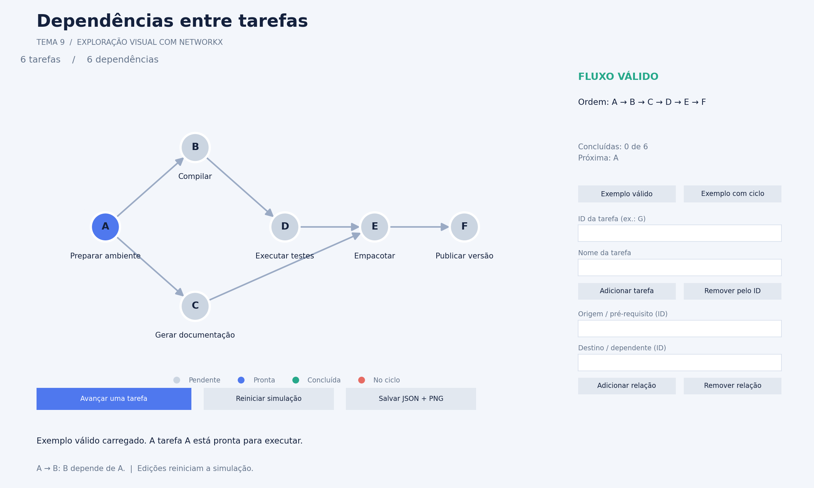
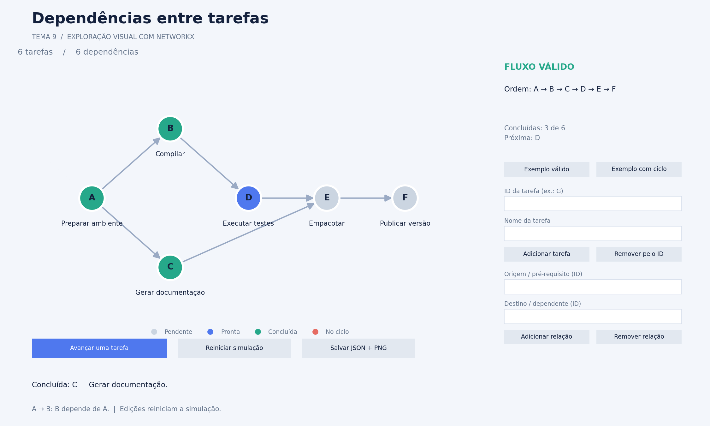
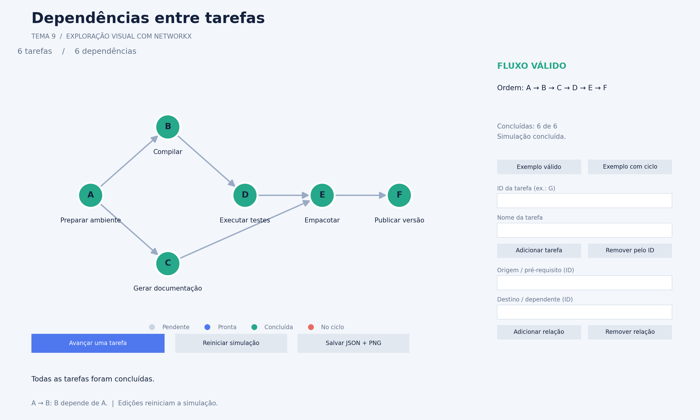
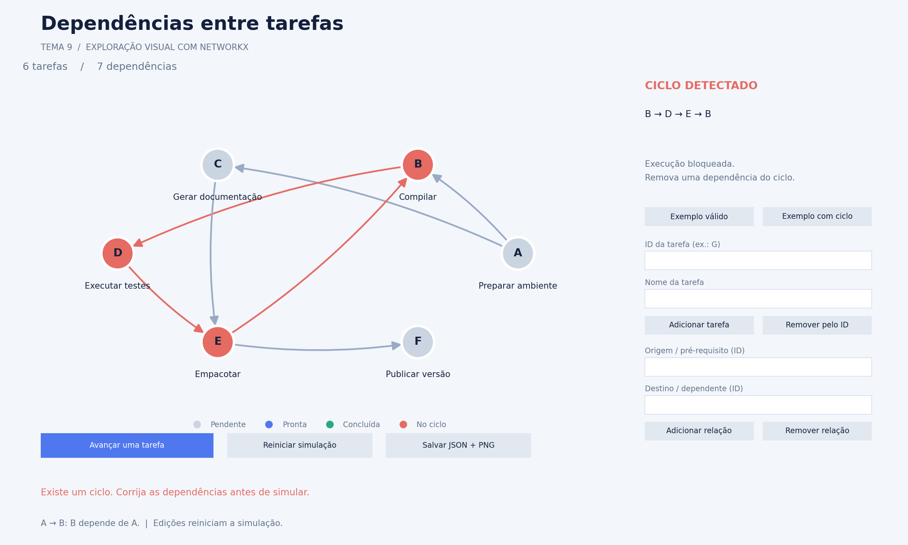
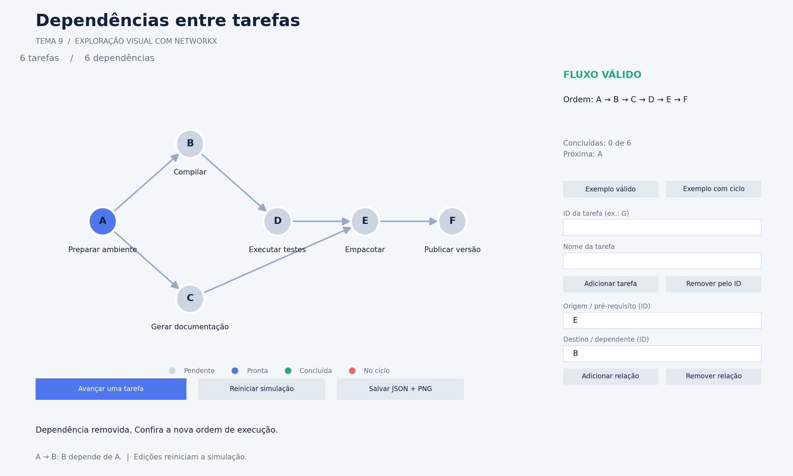
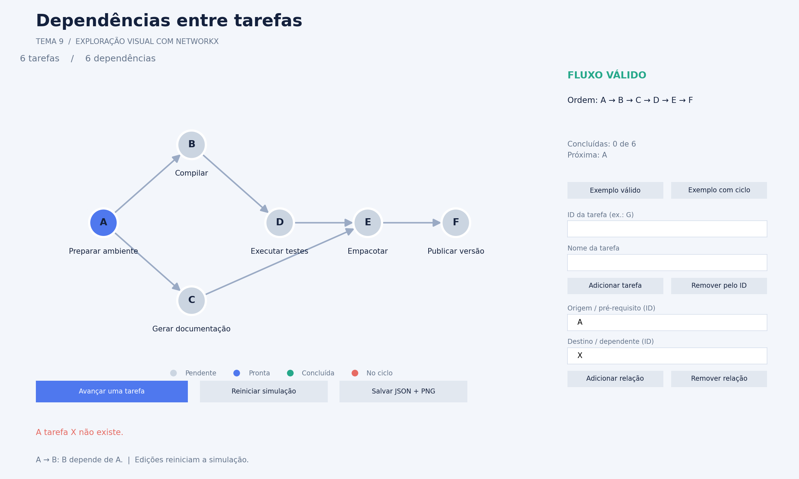
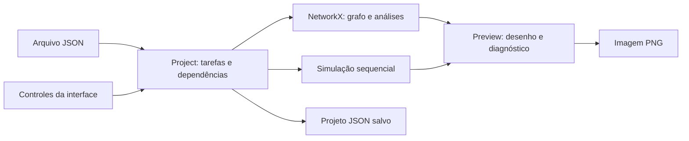

# Documentação do protótipo visual com NetworkX

Este documento descreve a versão exploratória implementada para o **tema 9 — Gestão de Conflitos em Sistemas de Dependência**. O protótipo permite visualizar tarefas, editar dependências, detectar ciclos e acompanhar uma simulação sequencial de execução.

O código está em [`prototypes/networkx_preview/`](../../prototypes/networkx_preview/). A aplicação usa Python, NetworkX e Matplotlib, com interface em uma janela local.

**Escopo acadêmico:** o enunciado permite bibliotecas prontas de grafos apenas para comparação de desempenho. Esta versão foi criada para exploração visual, a pedido do grupo, e usa NetworkX tanto na representação quanto na análise do grafo. A versão acadêmica final deverá seguir a exigência de implementação própria, salvo autorização do professor. O planejamento completo está em [agent.md](../../agent.md).

## 1. Objetivo e funcionalidades disponíveis

O problema representado é o de tarefas que precisam aguardar outras tarefas para executar. Uma dependência circular impede uma sequência completa que respeite todos os pré-requisitos.

O protótipo já permite:

- Adicionar tarefas com ID e nome e removê-las pelo ID.
- Adicionar e remover dependências entre tarefas existentes.
- Visualizar o grafo com setas e nomes.
- Alternar entre exemplos sintéticos com e sem ciclo.
- Mostrar uma ordenação topológica quando não há ciclo.
- Destacar um ciclo encontrado e bloquear a simulação.
- Concluir uma tarefa por clique, respeitando seus pré-requisitos.
- Reiniciar a simulação.
- Salvar tarefas e dependências em JSON e a imagem da interface em PNG.
- Carregar um JSON e exportar imagens por linha de comando.

Não há execução real de comandos, instalação de pacotes ou duração de tarefas. Cada passo representa apenas a conclusão simulada de uma tarefa.

## 2. Instalação e execução

Requer Python 3.9 ou superior. Execute na raiz do repositório:

```bash
python3 -m venv .venv
source .venv/bin/activate
python -m pip install -r prototypes/networkx_preview/requirements.txt
python -m prototypes.networkx_preview
```

No Windows, a ativação do ambiente no PowerShell é feita com `.venv\Scripts\Activate.ps1` no lugar de `source .venv/bin/activate`.

As versões fixadas para esta versão do protótipo são NetworkX 3.2.1 e Matplotlib 3.9.4. A janela requer um backend gráfico disponível no ambiente. Em servidores ou ambientes sem interface gráfica, use os comandos de exportação de imagens.

### Comandos disponíveis

| Ação | Comando na raiz do repositório |
| --- | --- |
| Abrir o exemplo padrão | `python -m prototypes.networkx_preview` |
| Abrir exemplo sem ciclo | `python -m prototypes.networkx_preview --exemplo sem_ciclo` |
| Abrir exemplo com ciclo | `python -m prototypes.networkx_preview --exemplo com_ciclo` |
| Abrir projeto salvo | `python -m prototypes.networkx_preview --arquivo outputs/prototipo-networkx/projeto.json` |
| Ver argumentos | `python -m prototypes.networkx_preview --help` |
| Exportar imagem sem janela | `python -m prototypes.networkx_preview --exportar outputs/grafo.png` |
| Exportar exemplo com ciclo | `python -m prototypes.networkx_preview --exemplo com_ciclo --exportar outputs/ciclo.png` |

As opções `--arquivo` e `--exemplo` são alternativas entre si. A exportação pode ser combinada com qualquer uma delas.

## 3. Modelagem e exemplo utilizado

O grafo é dirigido e sem pesos. Cada vértice representa uma tarefa, e cada aresta representa um pré-requisito obrigatório.

**Convenção: `A → B` significa que B depende de A.** A tarefa A deve terminar antes de B.

| ID | Tarefa | Pré-requisitos no exemplo sem ciclo |
| --- | --- | --- |
| A | Preparar ambiente | Nenhum. |
| B | Compilar | A. |
| C | Gerar documentação | A. |
| D | Executar testes | B. |
| E | Empacotar | C e D. |
| F | Publicar versão | E. |

O exemplo sem ciclo possui seis tarefas e seis dependências. Uma ordem válida é `A → B → C → D → E → F`. Outras ordens podem ser corretas, desde que respeitem todas as dependências.

O exemplo com conflito adiciona `E → B`, formando o ciclo `B → D → E → B`. A tarefa F fica bloqueada por depender de E, mas não pertence a esse ciclo.

Os dados são sintéticos e estão nos arquivos [sem_ciclo.json](../../prototypes/networkx_preview/examples/sem_ciclo.json) e [com_ciclo.json](../../prototypes/networkx_preview/examples/com_ciclo.json).

## 4. Interface e galeria de imagens

As imagens abaixo são renderizações da mesma figura, dos controles e dos estados usados pela aplicação, produzidas pelo Matplotlib sem abrir uma janela. Elas mostram a área interna da interface, sem a moldura da janela ou a barra de ferramentas do sistema operacional.

Cada imagem tem resolução de **2250 × 1350 pixels**. Os cenários foram gerados a partir dos exemplos e das ações reais do protótipo, sem montagem manual.

### 4.1. Interface inicial



À esquerda aparecem as tarefas e suas dependências. À direita ficam o diagnóstico, a ordem de execução e os campos de edição. A parte inferior contém os botões de simulação e salvamento e a mensagem da última ação.

Inicialmente, apenas A está pronta para executar. O painel indica zero tarefas concluídas e A como próxima tarefa.

### 4.2. Simulação em andamento



Depois de três avanços, A, B e C estão concluídas. D está pronta; E ainda depende da conclusão de D. A ordem escolhida continua sendo respeitada, mesmo quando mais de uma tarefa poderia estar disponível.

### 4.3. Simulação concluída



Após a conclusão das seis tarefas, todos os vértices ficam verdes e o painel informa que a simulação terminou. Novos cliques em avançar não executam tarefas adicionais. O botão **Reiniciar simulação** permite começar novamente com o mesmo grafo.

### 4.4. Ciclo detectado e execução bloqueada



O caminho `B → D → E → B` aparece em vermelho. A imagem registra uma tentativa de avançar, com a mensagem de bloqueio. Nenhuma tarefa é concluída, mesmo que haja uma tarefa independente do ciclo disponível em outra parte do grafo.

O programa destaca apenas um ciclo encontrado. Vértices fora desse caminho não são marcados como integrantes do ciclo apenas por estarem bloqueados.

### 4.5. Correção do conflito



Preenchendo origem `E` e destino `B` e clicando em **Remover relação**, o ciclo do exemplo é desfeito. A visualização volta à disposição por camadas, a ordem topológica reaparece e a simulação pode ser iniciada.

A remoção reinicia os estados da simulação. Os campos preenchidos permanecem visíveis para mostrar qual dependência foi removida.

### 4.6. Validação de entrada



A tentativa de cadastrar `A → X`, sem que X exista, é rejeitada. A mensagem explica o problema, e o grafo mantém suas seis dependências originais.

### Legenda dos estados

| Cor | Significado |
| --- | --- |
| Cinza | Tarefa pendente. |
| Azul | Tarefa pronta: seus pré-requisitos já foram concluídos. |
| Verde | Tarefa concluída na simulação. |
| Vermelho | Vértice ou aresta do ciclo destacado; também é usado em mensagens de erro. |

Na presença de ciclo, a aplicação bloqueia a simulação completa e deixa de sinalizar tarefas como prontas. Os textos do diagnóstico e das mensagens complementam a indicação por cor.

## 5. Roteiro de uso

1. Abra o protótipo e escolha **Exemplo válido**.
2. Observe a direção das setas e a ordem apresentada no painel.
3. Clique em **Avançar uma tarefa** para concluir a próxima tarefa e acompanhar a atualização das cores.
4. Clique em **Reiniciar simulação** para limpar as conclusões.
5. Cadastre uma tarefa preenchendo ID e nome e clicando em **Adicionar tarefa**.
6. Cadastre uma relação usando o ID do pré-requisito como origem e o ID da tarefa dependente como destino.
7. Para remover uma tarefa, preencha seu ID e clique em **Remover pelo ID**; suas dependências também serão removidas.
8. Escolha **Exemplo com ciclo** e tente avançar para observar o bloqueio.
9. Remova a relação `E → B` para corrigir o exemplo e voltar à simulação.
10. Use **Salvar JSON + PNG** para guardar o projeto e a imagem atual.

Trocar de exemplo substitui o projeto aberto. Alterações efetivas no grafo invalidam a ordem anterior e reiniciam a simulação; inserir uma aresta já existente não duplica a relação nem reinicia os estados.

## 6. Arquitetura e organização do código

| Arquivo | Responsabilidade |
| --- | --- |
| [`model.py`](../../prototypes/networkx_preview/model.py) | Classe `Project`, validação, grafo, persistência e simulação. |
| [`app.py`](../../prototypes/networkx_preview/app.py) | Classe `Preview`, desenho da interface, controles e argumentos de linha de comando. |
| [`__main__.py`](../../prototypes/networkx_preview/__main__.py) | Entrada para executar o pacote com `python -m`. |
| [`gerar_imagens.py`](../../prototypes/networkx_preview/gerar_imagens.py) | Reprodução dos seis cenários ilustrados neste documento. |
| [`examples/`](../../prototypes/networkx_preview/examples/) | Projetos JSON sintéticos para demonstração. |
| [`test_preview.py`](../../prototypes/networkx_preview/test_preview.py) | Testes do modelo e dos fluxos da interface. |
| [`requirements.txt`](../../prototypes/networkx_preview/requirements.txt) | Dependências e versões utilizadas. |

O modelo é independente da janela. A interface aplica as ações ao modelo e atualiza grafo, diagnóstico e estados.



### Uso do NetworkX nesta versão

- `nx.DiGraph`: armazenamento das tarefas e das arestas dirigidas.
- `nx.find_cycle`: busca de um ciclo para diagnóstico e destaque.
- `nx.topological_sort`: ordenação das tarefas quando o grafo é acíclico.
- `nx.topological_generations`: organização dos grafos acíclicos em camadas.
- `nx.circular_layout`: posicionamento dos vértices nos grafos com ciclos.
- Funções de desenho do NetworkX com Matplotlib: vértices, setas e identificadores.

Antes de cada avanço, o programa calcula a ordem e confere os pré-requisitos da tarefa selecionada. A lista de tarefas concluídas pertence apenas à sessão atual.

Essa implementação serve para validar a proposta. A análise e a implementação própria dos algoritmos acadêmicos estão descritas no [guia geral](../../agent.md).

## 7. Formato dos dados e persistência

Exemplo mínimo:

```json
{
  "tarefas": [
    {"id": "A", "nome": "Preparar ambiente", "descricao": ""},
    {"id": "B", "nome": "Compilar", "descricao": "Depende do ambiente"}
  ],
  "dependencias": [
    {"origem": "A", "destino": "B"}
  ]
}
```

O JSON deve conter as listas `tarefas` e `dependencias`. Cada tarefa precisa de ID único e nome não vazio; `descricao` é opcional e deve ser texto. Origem e destino devem identificar tarefas já cadastradas.

Grafos vazios, tarefas isoladas e componentes desconexas são aceitos. Laços, como `A → A`, são aceitos para análise e identificados como ciclos. Dependências duplicadas são ignoradas.

O botão de salvamento grava, a partir da pasta de execução:

```text
outputs/prototipo-networkx/
├── projeto.json
└── grafo.png
```

Esses nomes são fixos, e salvar novamente substitui os arquivos anteriores. O JSON preserva tarefas, descrições e dependências, mas não o progresso da simulação. Para reabri-lo, use `--arquivo`; não há um botão de abertura de arquivo na interface atual.

## 8. Reprodução das imagens

Com o ambiente ativado e as dependências instaladas, execute na raiz:

```bash
python -m prototypes.networkx_preview.gerar_imagens
```

Esse comando gera novamente os seis PNGs em [`imagens/`](imagens/), substituindo as versões anteriores. O script configura o backend `Agg`, carrega os exemplos e usa os mesmos controles e métodos de ação da aplicação para preparar cada estado. Não requer uma janela aberta nem captura de tela do computador.

Para usar outra pasta:

```bash
python -m prototypes.networkx_preview.gerar_imagens --destino outputs/imagens-documentacao
```

As imagens resumidas anteriores, sem os controles de edição, continuam disponíveis em [sem-ciclo.png](sem-ciclo.png) e [com-ciclo.png](com-ciclo.png). Elas podem ser reproduzidas com:

```bash
python -m prototypes.networkx_preview --exportar docs/prototipo-networkx/sem-ciclo.png
python -m prototypes.networkx_preview --exemplo com_ciclo --exportar docs/prototipo-networkx/com-ciclo.png
```

## 9. Testes disponíveis

Na raiz do repositório, com o ambiente ativado:

```bash
MPLBACKEND=Agg python -m unittest prototypes.networkx_preview.test_preview -v
```

A suíte contém 11 testes que verificam:

- A presença de todas as tarefas na ordenação e o respeito a cada dependência.
- A conclusão sequencial com pré-requisitos satisfeitos.
- A existência real do caminho de ciclo e o bloqueio de toda a execução.
- A invalidação da simulação após edição e a remoção de arestas associadas a uma tarefa.
- O tratamento de arestas duplicadas e entradas inválidas.
- A preservação dos dados ao salvar e reabrir JSON.
- Grafos vazios, tarefas isoladas, laços e ciclos em componentes desconexas.
- A renderização dos cenários principais e as ações de edição e simulação da interface.

Os testes de renderização usam `Agg` e não verificam a integração da janela com o sistema operacional. As imagens são evidências visuais dos cenários demonstrados; não constituem medições de desempenho.

## 10. Limitações e próximos passos

Esta versão é voltada a grafos pequenos e demonstrações. Ainda não possui:

- Edição do nome de uma tarefa já cadastrada pela interface.
- Botão para selecionar arquivos de entrada; a abertura é feita pela linha de comando.
- Histórico textual completo das tarefas executadas.
- Rolagem ou adaptação do painel para grafos grandes.
- Exibição simultânea de todos os ciclos.
- Execução paralela, prioridades, duração ou tratamento de falhas reais de tarefas.
- Experimentos de desempenho.
- Estrutura e algoritmos próprios exigidos para a versão acadêmica.

Os próximos passos são avaliar os fluxos com o grupo, implementar o núcleo próprio de grafos e algoritmos e integrar a interface da versão final. Os resultados experimentais e os artefatos de modelagem deverão ganhar documentação própria em `docs/` à medida que forem produzidos.

---

[Voltar ao índice da documentação](../README.md) · [Voltar à apresentação do projeto](../../README.md)
