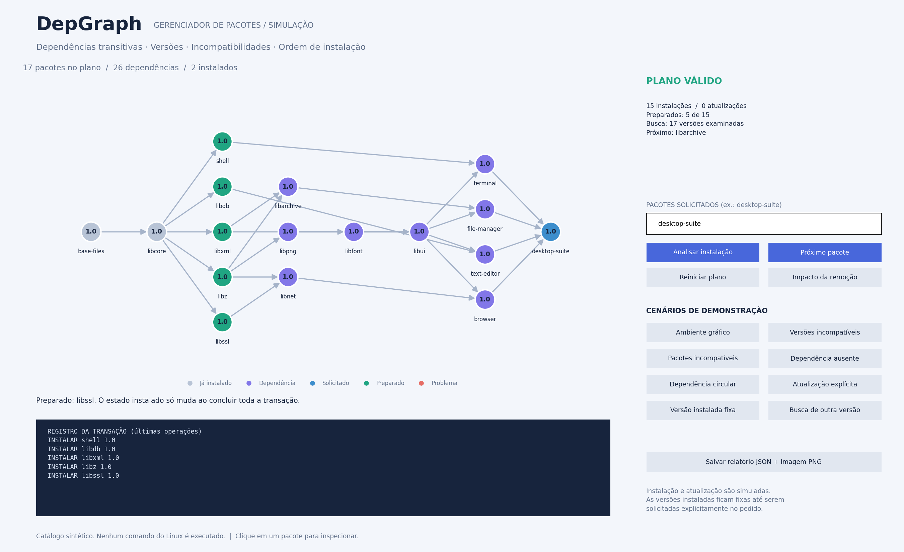
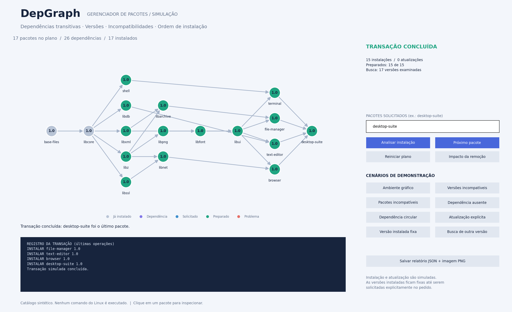
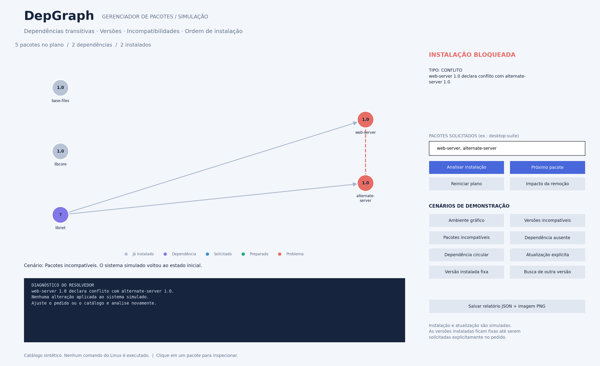
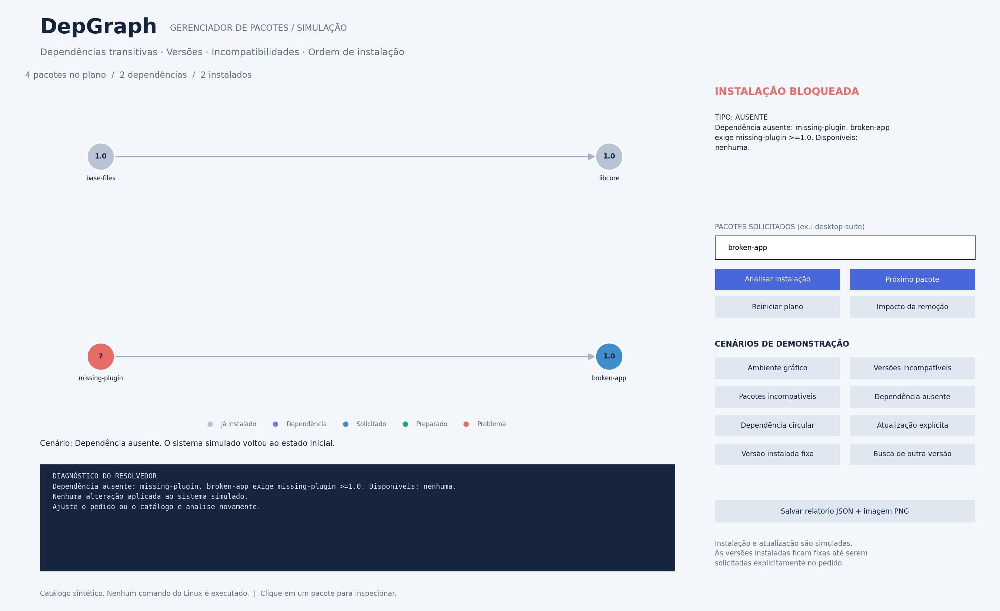
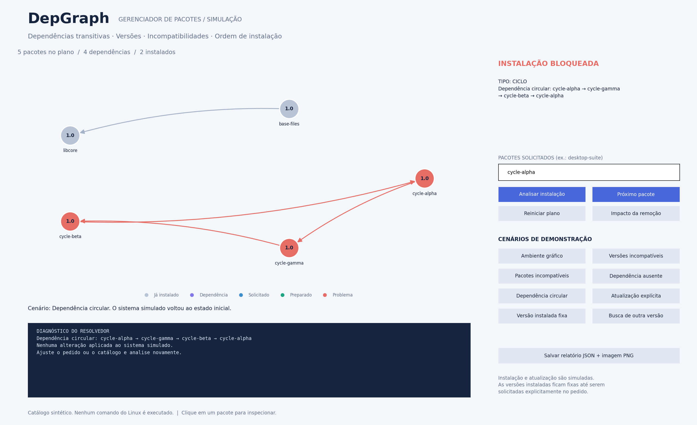
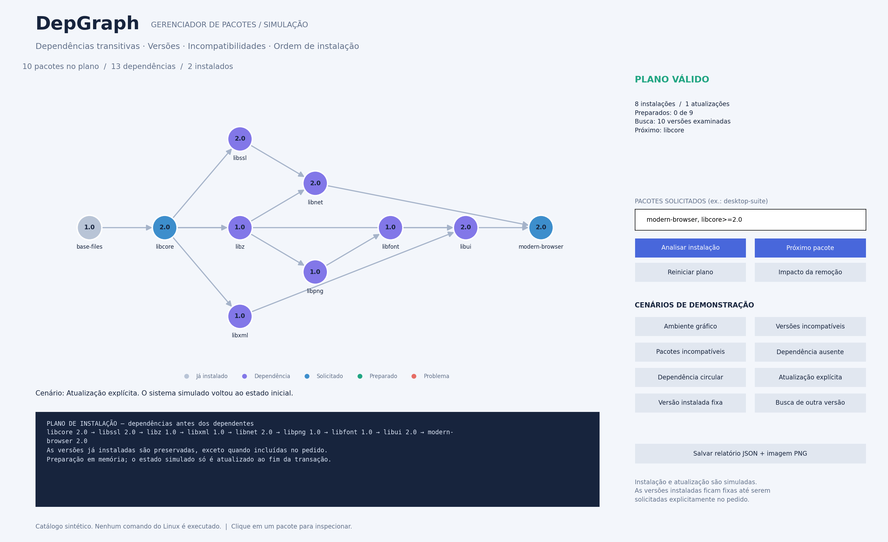
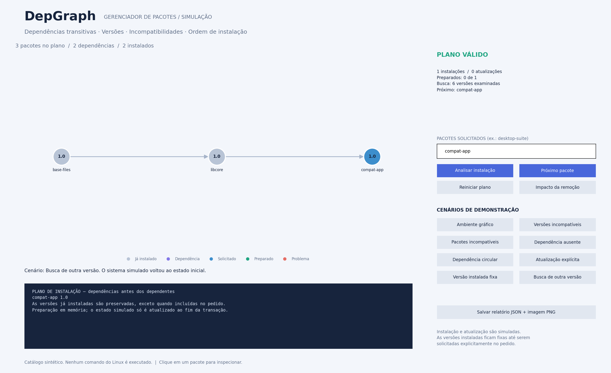

# DepGraph — Simulador de conflitos entre pacotes

Protótipo do **tema 9 — Gestão de Conflitos em Sistemas de Dependência**, com foco em um gerenciador de pacotes inspirado no Linux. A aplicação resolve um pedido de instalação usando um catálogo, versões disponíveis e um conjunto de pacotes já instalados.

O protótipo usa NetworkX para grafos e Matplotlib para a interface. A versão acadêmica final precisará da implementação própria exigida no [enunciado](../../TP.pdf). O primeiro exemplo de tarefas foi substituído; suas telas estão no [registro histórico](tarefas-historico.md).

## 1. Problema e escopo

Ao instalar um aplicativo, também pode ser necessário instalar bibliotecas, as dependências dessas bibliotecas e assim por diante. Dois aplicativos podem exigir versões incompatíveis de uma mesma biblioteca ou declarar que não podem coexistir.

O DepGraph representa esse problema com:

- Catálogo de **27 nomes de pacotes e 32 versões**.
- Estado inicial com `base-files 1.0` e `libcore 1.0` instalados.
- Dependências diretas e transitivas com restrições de versão.
- Incompatibilidades explícitas entre pacotes.
- Detecção de dependências ausentes e circulares.
- Seleção de versões por busca com retrocesso (*backtracking*).
- Plano de instalação e atualização em ordem topológica.
- Preparação passo a passo e conclusão da transação simulada.
- Análise de impacto de remoção usando dependentes transitivos.

Os dados são **sintéticos**. Nomes, relações e versões não são metadados oficiais de nenhuma distribuição. Nenhum comando do sistema operacional é executado.

## 2. Relação com o Linux e com o enunciado

A inspiração vem das relações entre pacotes, como dependências e incompatibilidades descritas na [Debian Policy](https://www.debian.org/doc/debian-policy/ch-relationships.html). Dependências de versão e conflitos de coexistência são problemas distintos e aparecem como diagnósticos separados no protótipo.

Este é um modelo didático com regras próprias, e não uma implementação de APT ou dpkg. Ele usa versões numéricas simplificadas e uma política estrita de rejeição de ciclos para demonstrar a ordenação topológica exigida no tema. O Debian possui tratamento específico para certos ciclos de `Depends`, descrito na mesma referência; portanto, não se deve afirmar que todo ciclo implica rejeição por qualquer gerenciador Linux.

O enunciado permite modelar tarefas **ou pacotes**. A escolha atual do grupo é trabalhar com pacotes. As regras de versão e incompatibilidade ampliam o cenário de aplicação, mantendo grafos, ciclos, visualização e ordem de execução como núcleo.

## 3. Instalação e comandos

Requer Python 3.9 ou superior. Na raiz do repositório:

```bash
python3 -m venv .venv
source .venv/bin/activate
python -m pip install -r prototypes/networkx_preview/requirements.txt
python -m prototypes.networkx_preview
```

No Windows/PowerShell, use `.venv\Scripts\Activate.ps1` para ativar o ambiente. A interface local requer um backend gráfico do Matplotlib. Para gerar imagens em ambiente sem janela, use `--exportar`.

| Ação | Comando |
| --- | --- |
| Abrir a instalação de um ambiente gráfico | `python -m prototypes.networkx_preview` |
| Demonstrar conflito de versões | `python -m prototypes.networkx_preview --cenario versoes` |
| Demonstrar incompatibilidade explícita | `python -m prototypes.networkx_preview --cenario conflito` |
| Demonstrar dependência ausente | `python -m prototypes.networkx_preview --cenario ausente` |
| Demonstrar ciclo | `python -m prototypes.networkx_preview --cenario ciclo` |
| Demonstrar atualização | `python -m prototypes.networkx_preview --cenario upgrade` |
| Demonstrar bloqueio por versão instalada | `python -m prototypes.networkx_preview --cenario instalado` |
| Demonstrar seleção de outra versão | `python -m prototypes.networkx_preview --cenario alternativa` |
| Informar pedido próprio | `python -m prototypes.networkx_preview --pedidos "web-server, text-editor"` |
| Listar catálogo e relações | `python -m prototypes.networkx_preview --listar` |
| Usar catálogo próprio | `python -m prototypes.networkx_preview --catalogo caminho/catalogo.json` |
| Exportar a interface sem janela | `python -m prototypes.networkx_preview --cenario versoes --exportar outputs/versoes.png` |

Na interface, os botões de cenário usam o catálogo carregado e restauram seu estado inicial. Nomes dos cenários da demonstração exigem que o catálogo contenha os respectivos pacotes.

## 4. Modelagem e resolução

### Vértices e arestas

O catálogo guarda várias versões por nome. Cada versão possui suas próprias dependências e incompatibilidades. Durante a resolução, o sistema escolhe **no máximo uma versão para cada nome de pacote**.

O grafo de um plano contém um vértice por nome e a versão selecionada como atributo. Uma aresta **`A → B` significa que B depende de A**. A ordenação topológica, portanto, coloca as dependências antes dos dependentes.

As relações de incompatibilidade não entram na ordenação topológica. Quando detectadas, são ilustradas por uma linha vermelha tracejada entre os pacotes conflitantes.

### Restrições de versão

São aceitas versões com um a três componentes numéricos, como `1`, `1.0` ou `2.1.3`, comparadas numericamente. Os operadores são `=`, `==`, `>=`, `<=`, `>` e `<`.

Nos metadados JSON, intervalos podem combinar restrições: `>=1.0,<2.0`. No campo de pedidos, cada item aceita uma condição; itens separados por vírgula são combinados, como `libssl>=1.0, libssl<2.0`.

Um exemplo de conflito do catálogo:

- `modern-browser 2.0` precisa de `libnet >=2.0`.
- `libnet 2.0` precisa de `libssl >=2.0`.
- `legacy-backup 1.0` precisa de `libssl <2.0`.
- Nenhuma versão única de `libssl` satisfaz as duas restrições.

Esse problema existe mesmo que o grafo de dependências não contenha ciclo.

### Etapas do resolvedor

1. Interpretar o pedido e preservar os pacotes já instalados.
2. Fixar as versões instaladas dos nomes que não foram incluídos explicitamente no pedido.
3. Escolher candidatos, preferindo versões mais altas, e expandir suas dependências transitivas.
4. Acumular as restrições de todos os solicitantes de uma mesma biblioteca.
5. Verificar incompatibilidades declaradas por qualquer pacote selecionado, inclusive os já instalados.
6. Se uma escolha falhar, tentar outra versão e descartar as dependências da escolha anterior.
7. Construir o grafo completo, verificar ciclos e obter a ordem topológica.
8. Gerar operações apenas para instalações ou mudanças de versão realmente necessárias.

O algoritmo busca uma solução viável dentro dessas regras. Não otimiza tamanho de download, número de mudanças ou preferência global de versões. Há limite de 20 mil escolhas de candidatos e de profundidade de seleção; atingir um limite produz diagnóstico **inconclusivo**, e não uma prova de inexistência de solução.

A resolução por backtracking pode ter custo exponencial. A ordenação topológica e a busca de ciclos, isoladamente, têm custo `O(V + E)` no grafo selecionado. Não atribuir esse custo linear ao resolvedor completo.

### Atualização e segurança da simulação

As versões instaladas são preservadas por padrão. Para permitir atualizar `libcore`, é necessário incluí-la no pedido, por exemplo `modern-browser, libcore>=2.0`. As dependências dos pacotes já instalados continuam sendo verificadas, impedindo que uma atualização quebre um dependente preservado.

Cada avanço prepara um pacote em memória. O conjunto instalado só muda depois que todas as operações do plano foram concluídas e o estado final foi validado. Reiniciar um plano parcial descarta a preparação. Reiniciar depois de uma transação concluída não desinstala os pacotes; trocar de cenário restaura a base sintética.

## 5. Interface e galeria

As imagens são renderizações da interface real com seus controles, produzidas pelo Matplotlib usando o backend `Agg`, sem moldura do sistema operacional. Cada PNG possui **2700 × 1650 pixels**.

### 5.1. Instalação de um ambiente gráfico


O pedido `desktop-suite` resulta em 17 pacotes e 26 dependências. Como dois pacotes já estão instalados, são previstas 15 instalações. As bibliotecas compartilhadas aparecem uma única vez, mesmo quando exigidas por vários aplicativos.

### 5.2. Transação em andamento



Após cinco avanços, os pacotes preparados aparecem em verde. O estado instalado permanece com os dois pacotes iniciais até a conclusão de toda a transação.

### 5.3. Transação concluída



A transação termina com 17 pacotes instalados no estado em memória. O registro mostra as últimas operações. Não houve instalação real no computador.

### 5.4. Versões incompatíveis


O pedido conjunto de navegador moderno e backup legado exige intervalos incompatíveis de `libssl`. O diagnóstico identifica os pacotes que impõem cada condição e as versões disponíveis.

### 5.5. Pacotes incompatíveis



O catálogo fictício declara que `web-server` conflita com `alternate-server`. A linha tracejada representa incompatibilidade, não dependência. Essa é uma regra explícita do exemplo; pacotes não são considerados conflitantes apenas por exercer funções semelhantes.

### 5.6. Dependência ausente



`broken-app` exige `missing-plugin`, que não existe no catálogo. O vértice é mostrado com versão `?`, e a transação é bloqueada.

### 5.7. Dependência circular



O ciclo é apresentado com caminho fechado. O diagnóstico segue a orientação das arestas do grafo: dependência para dependente. Nenhuma ordenação topológica completa existe para esse plano.

### 5.8. Atualização explícita



O pedido `modern-browser, libcore>=2.0` permite a mudança de `libcore 1.0` para `2.0`, além da instalação das dependências necessárias. Sem incluir `libcore` no pedido, o cenário **Versão instalada fixa** explica o bloqueio pela política de preservação.

### 5.9. Seleção de uma versão alternativa



`compat-app 2.0` depende de um SDK ausente. O resolvedor retrocede e encontra `compat-app 1.0`, cujas dependências estão disponíveis. O SDK da tentativa descartada não permanece no plano final.

### 5.10. Impacto de uma remoção


Após concluir a instalação do ambiente, informar `libcore` e clicar em **Impacto da remoção** mostra os dependentes diretos e transitivos afetados e a ordem inversa para uma eventual remoção em cascata. Essa ação apenas analisa o impacto; não remove pacotes.

### Cores e inspeção

| Indicação | Significado |
| --- | --- |
| Cinza | Versão já instalada e mantida. |
| Roxo | Dependência a preparar. |
| Azul | Pacote solicitado diretamente. |
| Verde | Pacote preparado na transação. |
| Vermelho | Pacote envolvido no diagnóstico. |
| Linha tracejada vermelha | Incompatibilidade explícita entre pacotes. |

Clique em um vértice para consultar versões disponíveis, versão instalada, dependências e incompatibilidades no painel inferior. Em planos bloqueados, o grafo mostra uma tentativa de seleção que evidencia o problema, e não uma solução instalável. O destaque pode mostrar um dos conflitos encontrados; não há enumeração de todos os conflitos possíveis.

## 6. Catálogo e saída de dados

O catálogo de entrada usa este formato:

```json
{
  "instalados": {"base-files": "1.0"},
  "pacotes": [
    {"nome": "base-files", "versao": "1.0"},
    {
      "nome": "aplicativo", "versao": "1.0",
      "depende": [{"nome": "base-files", "versao": ">=1.0"}],
      "conflita": [{"nome": "outro-aplicativo"}]
    }
  ]
}
```

Cada versão de um pacote ocupa uma entrada. `depende`, `conflita` e `descricao` são opcionais. Uma relação sem restrição de versão aceita qualquer versão. Não são permitidas entradas duplicadas com nome e versão numericamente equivalentes. O estado inicial instalado deve existir no catálogo, satisfazer as dependências, não conter incompatibilidades e ser acíclico segundo a política do simulador.

O botão **Salvar relatório JSON + imagem PNG** grava `outputs/prototipo-networkx/pacotes.json` e `outputs/prototipo-networkx/pacotes.png`, substituindo versões anteriores. O JSON contém pedido, versões selecionadas, estado instalado, operações, diagnósticos e histórico. Esse relatório não é um catálogo reabrível com `--catalogo`; os formatos têm finalidades diferentes.

## 7. Código e testes

| Arquivo | Responsabilidade |
| --- | --- |
| [package_model.py](../../prototypes/networkx_preview/package_model.py) | Catálogo, versões, requisitos, backtracking, plano, transação e impacto de remoção. |
| [package_app.py](../../prototypes/networkx_preview/package_app.py) | Interface, cenários, inspeção de pacotes e exportação. |
| [pacotes.json](../../prototypes/networkx_preview/examples/pacotes.json) | Catálogo sintético e estado instalado inicial. |
| [test_packages.py](../../prototypes/networkx_preview/test_packages.py) | Testes da resolução, transações e interface de pacotes. |
| [gerar_imagens.py](../../prototypes/networkx_preview/gerar_imagens.py) | Reprodução dos dez cenários da galeria. |

Execute os testes atuais e os testes preservados do primeiro exemplo com:

```bash
MPLBACKEND=Agg python -m unittest prototypes.networkx_preview.test_packages prototypes.networkx_preview.test_preview -v
```

A suíte inclui 29 testes: 18 de pacotes e 11 históricos de tarefas. São verificados fechamento transitivo, ordenação, restrições, conflitos em ambas as direções, versões instaladas, dependentes preservados, retrocesso, ciclos, limite de busca, estado parcial de transação, remoção e renderização. A renderização automatizada não substitui uma verificação da integração da janela com o sistema operacional.

## 8. Reproduzir as imagens

Na raiz, com as dependências instaladas:

```bash
python -m prototypes.networkx_preview.gerar_imagens
```

O comando gera os dez PNGs `pacotes-*.png` em `docs/prototipo-networkx/imagens/`. Para outra pasta:

```bash
python -m prototypes.networkx_preview.gerar_imagens --destino outputs/imagens-pacotes
```

As imagens antigas de tarefas permanecem identificadas no documento histórico e não são a apresentação atual do projeto.

## 9. Limitações e evolução

Este simulador não implementa os formatos e toda a semântica de Debian/RPM, comparação de versões do dpkg, arquiteturas, repositórios remotos, pacotes virtuais, dependências alternativas com `|`, scripts de manutenção, conflitos de arquivos, recomendações, otimização global ou recuperação de falhas reais.

Também não remove pacotes automaticamente para resolver conflitos. Os pacotes instalados são preservados e só podem mudar de versão se forem explicitamente incluídos no pedido. A política torna a demonstração previsível e seus bloqueios devem ser interpretados dentro desse escopo.

Para a entrega acadêmica, o próximo passo é implementar a estrutura própria de grafo, DFS, ordenação topológica e busca de dependentes; manter a resolução de restrições como camada separada; realizar experimentos; produzir UML e relatório SBC. A complexidade da busca de versões deverá ser analisada além da complexidade dos algoritmos de grafos.

[Índice da documentação](../README.md) · [Guia geral](../../agent.md) · [Apresentação do projeto](../../README.md)
